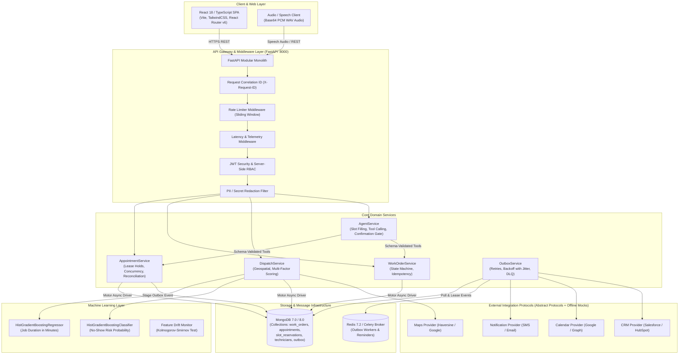
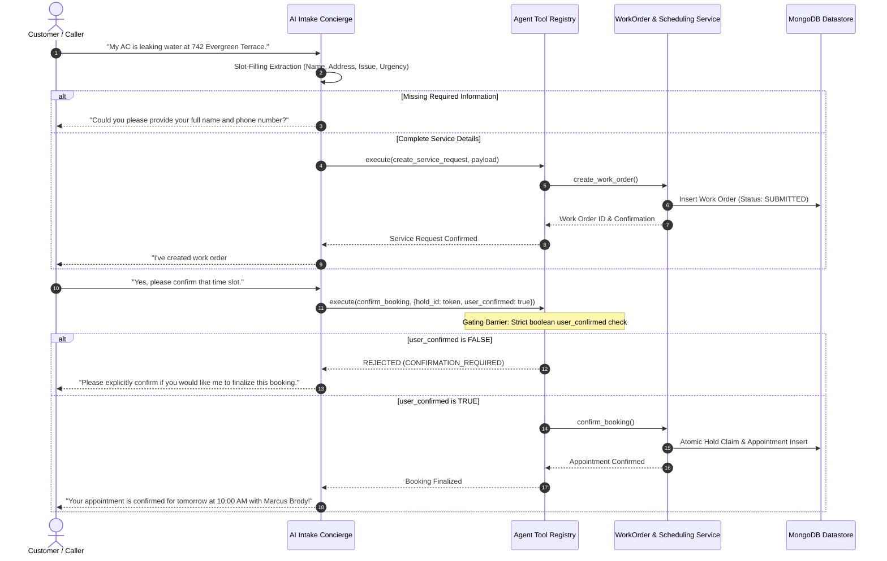

# FieldOps AI — Voice-Based Field Service Management Platform

> **Autonomous customer intake, schema-validated work order structuring, intelligent multi-factor technician dispatch, and conflict-free appointment booking.**

[](https://www.python.org/)
[](https://fastapi.tiangolo.com/)
[](https://www.mongodb.com/)
[](https://react.dev/)
[](https://www.typescriptlang.org/)
[](https://www.docker.com/)
[](tests/)
[](https://astral.sh/ruff)

---

## Quick Navigation

- [Overview & Workflow](#overview)
- [Key Features](#key-features)
- [System Architecture](#system-architecture)
- [Technology Stack](#technology-stack)
- [Repository Structure](#repository-structure)
- [Prerequisites & Quick Start](#quick-start)
- [Environment Configuration](#environment-variables)
- [API Documentation](#api-documentation)
- [Booking Integrity & Concurrency](#booking-integrity-and-reliability)
- [AI & Voice Intake Safety](#ai-and-voice-workflow)
- [Machine Learning Pipeline](#machine-learning-evaluation)
- [Security & Authorization](#security)
- [Testing & Quality Assurance](#testing-and-quality-assurance)
- [Production Deployment](#deployment)
- [End-to-End Demo Script](#demo-walkthrough)
- [Known Limitations & Roadmap](#limitations-and-roadmap)
- [Engineering Decisions & Trade-Offs](#engineering-decisions-and-trade-offs)
- [Interview & Portfolio Summary](#interview-and-portfolio-summary)
- [Key Documentation Links](#key-documentation-links)

---

## Overview

Field service organizations in HVAC, plumbing, electrical, and appliance repair face a common operational bottleneck: customer service intake happens through unstructured, chaotic telephone conversations and text messages. Dispatchers manually transcribe symptoms, look up schedules on disparate calendars, assess technician skill sets, and negotiate time slots—leading to **duplicate bookings, stranded technician holds, lost customer details, and dispatch delays**.

**FieldOps AI** solves this problem by combining:
1. **Autonomous Voice & Chat Intake:** An LLM-driven concierge that extracts customer identity, verified service addresses, diagnostic symptoms, and priority levels into structured drafts.
2. **Deterministic Validation Barrier:** Tool execution and booking operations are schema-validated and strictly barred from proceeding without explicit customer confirmation.
3. **Multi-Factor Dispatch Matching:** Evaluates certified skills, live GPS proximity (2dsphere geospatial indexing), historical ratings, and shift schedules to rank eligible technicians with transparent score explanations.
4. **Resilient Scheduling Engine:** Employs lease-based reservation holds, optimistic locking (`lock_version`), and partial index deduplication to eliminate race conditions and double-bookings under concurrent load.
5. **Machine Learning Operations:** Predicts job duration via Gradient Boosted Decision Trees and estimates missed-appointment risks on held-out temporal splits.

### Operational Request Flow

```
[Customer Voice / Chat]
          │
          ▼
1. Conversational Intake ──► Extract Name, Phone, Address, Category, Symptoms
          │
          ▼
2. Schema Validation Barrier ──► Verify Required Fields (Elicit Clarifications if Missing)
          │
          ▼
3. Work Order Created ──► Status: SUBMITTED (Assigned Priority & Urgency)
          │
          ▼
4. Dispatch Matching ──► Score Technicians (Skills 40%, Travel 30%, Rating 20%, Shift 10%)
          │
          ▼
5. Tentative Slot Hold ──► Atomic 10-Minute Lease (Calendar Slot Reserved)
          │
          ▼
6. Explicit Confirmation ──► Customer Affirmation Barrier (user_confirmed: true required)
          │
          ▼
7. Appointment Confirmed ──► Work Order: SCHEDULED, Outbox Notification Staged (SMS/Email)
          │
          ▼
8. Field Execution ──► Technician Portal: Diagnostics ──► Status: COMPLETED
```

---

## Key Features

### Core Operations
- **Structured Work Orders:** Enforces lifecycle transitions (`DRAFT` $\rightarrow$ `SUBMITTED` $\rightarrow$ `TRIAGED` $\rightarrow$ `SCHEDULED` $\rightarrow$ `IN_PROGRESS` $\rightarrow$ `COMPLETED`).
- **Technician Fleet Management:** Real-time GPS location tracking, skill certifications, shift scheduling, and Metro Atlanta territory management.
- **Dispatch Board:** Interactive ranking of candidate technicians with visual scoring factor breakdowns.
- **Mobile Field Portal:** One-tap status updates, diagnostic notes, and on-site job completion for assigned technicians.

### AI & Conversational Intake
- **Slot-Filling Telemetry:** Live completeness scoring and real-time draft state inspection.
- **Confirmation Barrier:** Consequential booking operations strictly require explicit boolean customer authorization.
- **Prompt Injection Defense:** Filters adversarial instructions ("Ignore all previous instructions...") without executing external tools.
- **Speech-to-Speech Processing:** Audio pipeline accepting binary WAV speech, transcribing user input, and synthesizing responsive PCM WAV audio frames.

### Reliability & Data Integrity
- **Double-Booking Prevention:** Atomic conditional MongoDB writes guarantee only one appointment can claim a technician's slot.
- **Idempotency Semantics:** SHA-256 request payload hashing ensures repeated confirmations return existing records without duplicating side effects.
- **Stranded Hold Reconciliation:** Background maintenance workers automatically release expired holds (>10 minutes) and recover in-flight confirmation leases.
- **Transactional Outbox Pattern:** Guarantees notifications and calendar sync events are staged in MongoDB transactions with exponential backoff and dead-letter queue (DLQ) replay.

### Machine Learning
- **Job Duration Prediction:** Regression model predicting job duration in minutes with dynamic upper/lower confidence bounds.
- **Missed-Appointment Risk Classification:** Categorizes booking risk into `LOW`, `MEDIUM`, and `HIGH` tiers with contributing factor explanations.
- **Reproducible Pipeline:** Deterministic data generation with temporal train/val/test splits preventing lookahead leakage.

---

## System Architecture



### Component Responsibilities

| Component | Directory | Responsibility |
| :--- | :--- | :--- |
| **API Routers** | [`app/api/v1/`](app/api/v1/) | Route endpoints, input validation, role dependency enforcement, HTTP status codes. |
| **Domain State Machines** | [`app/domain/`](app/domain/) | Pure business transition rules for Work Orders (`WorkOrderStateMachine`) and Appointments (`AppointmentStateMachine`). |
| **Data Repositories** | [`app/repositories/`](app/repositories/) | Async MongoDB abstraction layer with Motor (`AsyncIOMotorClient`), pagination, and 2dsphere geo queries. |
| **Application Services** | [`app/services/`](app/services/) | Multi-entity orchestration, atomic reservation leases, dispatch policies, outbox management. |
| **Conversational AI** | [`app/agent/`](app/agent/) | Intent parsing, slot-filling draft state machine, tool registry, confirmation gate, prompt injection defense. |
| **ML Engine** | [`app/ml/`](app/ml/) | Feature extraction, Gradient Boosting pipelines, evaluation metrics, artifact serialization. |
| **Outbox & Tasks** | [`app/tasks/`](app/tasks/) | Asynchronous outbox dispatching, scheduled appointment reminders, expired hold purges. |
| **Frontend SPA** | [`frontend/`](frontend/) | React 18 / TypeScript single page app with Dispatch Board, Mobile Field Portal, and Intake Concierge. |

---

## Technology Stack

| Layer | Technology | Version | Responsibility |
| :--- | :--- | :--- | :--- |
| **Backend Framework** | FastAPI | `0.115.5` | Asynchronous REST API framework, lifespan management, OpenAPI generation. |
| **ASGI Web Server** | Uvicorn | `0.32.1` | High-performance production ASGI web server. |
| **Programming Language** | Python | `3.12+` | Strongly typed backend services with native async/await. |
| **Data Storage** | MongoDB / Motor | `7.0 / 8.0` | Primary document store, 2dsphere geospatial queries, compound/partial indexing. |
| **Object Validation** | Pydantic v2 | `2.10.2` | Data validation, RFC 7807 problem details, environment configuration. |
| **Security & Auth** | bcrypt & PyJWT | `4.2.1 / 2.10.1` | Cryptographic password hashing (rounds=12) and signed JWT access tokens. |
| **Task Queue & Cache** | Celery & Redis | `5.4.0 / 7.2` | Asynchronous task queue, scheduled cron reminders, transactional outbox worker. |
| **Machine Learning** | scikit-learn & NumPy | `1.5.2 / 2.1.3` | HistGradientBoosting regressor/classifier, temporal data splits, drift detection. |
| **Frontend Framework** | React | `18.3.1` | UI rendering, state management, mobile field view, chat telemetry components. |
| **Language & Tooling** | TypeScript & Vite | `5.6.2 / 5.4.21` | Type-safe client codebase, fast compilation, production static asset bundling. |
| **Client Routing & Icons** | React Router & Lucide | `6.28.0 / 0.468` | Single-page client navigation, responsive icons. |
| **Styling** | TailwindCSS | `3.4.16` | Utility-first responsive design, mobile-first layouts. |
| **Testing & Linter** | Pytest & Vitest & Ruff | `8.3.4 / 2.1.9` | 100% passing backend/frontend automated tests and linting. |

---

## Repository Structure

```
fieldops-ai/
├── .env.example                     # Production environment variable reference
├── Dockerfile                       # Multi-stage production container build (non-root appuser)
├── docker-compose.yml               # Local stack orchestration (FastAPI, MongoDB, Redis, Celery)
├── pyproject.toml                   # Python dependencies, Ruff linter, and Pytest configuration
├── render.yaml                      # Render Blueprint infrastructure manifest for backend
├── README.md                        # Master repository documentation and guide
│
├── app/                             # Core Backend Application
│   ├── main.py                      # Application factory, lifespan, global middleware
│   ├── agent/                       # Conversational AI intake
│   │   └── tools.py                 # Schema-validated tool definitions & confirmation gate
│   ├── api/                         # API presentation layer
│   │   ├── deps.py                  # Authentication dependencies & require_roles() RBAC
│   │   ├── health.py                # Liveness (/health/live) and readiness (/health/ready) probes
│   │   ├── metrics.py               # Operational telemetry & Prometheus metric counters
│   │   └── v1/                      # API v1 routes
│   │       ├── agent.py             # Voice and chat intake endpoints
│   │       ├── appointments.py      # Slot holding, booking confirmation, reschedule, cancel
│   │       ├── auth.py              # User registration, login, token refresh, /me
│   │       ├── customers.py         # Customer account creation and address management
│   │       ├── dispatch.py          # Geospatial candidate matching & score breakdown
│   │       ├── integrations.py      # Outbox inspection & DLQ replay endpoints
│   │       ├── ml.py                # Duration prediction, risk classification, drift metrics
│   │       ├── technicians.py       # Fleet credentials, shifts, GPS telemetry updates
│   │       ├── webhooks.py          # Inbound SMS webhook ingestion with HMAC-SHA256 verification
│   │       └── work_orders.py       # Work order CRUD & state machine transition endpoints
│   ├── core/                        # Cross-cutting infrastructure
│   │   ├── config.py                # pydantic-settings configuration loading
│   │   ├── database.py              # Motor Async client & MongoDB connection pool management
│   │   ├── exceptions.py            # Standardized domain exceptions & RFC 7807 handlers
│   │   ├── logging.py               # Structured logging & PII redaction filter
│   │   ├── middleware.py            # Correlation IDs, rate limiter, latency measurement
│   │   └── security.py              # bcrypt password hashing & JWT token generation
│   ├── domain/                      # Pure business logic
│   │   ├── dispatch_policy.py       # Multi-factor scoring logic (Skills, Travel, Rating, Shift)
│   │   └── state_machine.py         # WorkOrder & Appointment transition validators
│   ├── integrations/                # External provider protocol interfaces & mock adapters
│   │   ├── calendar/                # Google Calendar & Microsoft Graph protocol + mock
│   │   ├── crm/                     # Salesforce & HubSpot protocol + mock
│   │   ├── llm/                     # OpenAI & Anthropic protocol + mock
│   │   ├── maps/                    # Google Maps & OSRM protocol + Haversine mock
│   │   ├── notifications/           # Twilio SMS & SendGrid email protocol + in-memory mock
│   │   └── voice/                   # Whisper STT & ElevenLabs TTS protocol + WAV mock
│   ├── ml/                          # Machine learning pipelines
│   │   ├── artifacts/               # Serialized models (duration_model.joblib, risk_model.joblib)
│   │   ├── data_generator.py        # Reproducible synthetic dataset generator (seed=42)
│   │   ├── duration_model.py        # HistGradientBoosting job duration regression pipeline
│   │   ├── risk_model.py            # HistGradientBoosting missed-appointment risk classifier
│   │   ├── schemas.py               # Input/output feature schemas & validation
│   │   ├── service.py               # In-process inference service with fallback boundaries
│   │   └── trainer.py               # Temporal train/val/test split & offline evaluation runner
│   ├── repositories/                # Async MongoDB data access layer
│   │   ├── appointment_repo.py      # Appointment collection operations & token lookups
│   │   ├── audit_repo.py            # Immutable audit event logging
│   │   ├── customer_repo.py         # Customer records & address lookups
│   │   ├── idempotency_repo.py      # Request hash acquisition, locking, and commitment
│   │   ├── outbox_repo.py           # Outbox event staging, pending queries, lease claims
│   │   ├── technician_repo.py       # Fleet skills, 2dsphere coordinates, active bookings
│   │   └── work_order_repo.py       # Work order records & state history
│   ├── scripts/                     # Operational scripts
│   │   ├── init_db.py               # Idempotent index initialization (2dsphere, unique, TTL)
│   │   └── seed_data.py             # Deterministic seed data (Metro Atlanta technicians & jobs)
│   ├── services/                    # Application orchestration services
│   │   ├── agent_service.py         # Session history, draft state machine, repair loop
│   │   ├── appointment_service.py   # Concurrency holds, lease claiming, booking reconciliation
│   │   ├── dispatch_service.py      # Candidate ranking with transparent score breakdown
│   │   ├── outbox_service.py        # Transactional outbox processor with exponential backoff
│   │   └── work_order_service.py    # Work order lifecycle & audit logging
│   └── tasks/                       # Celery asynchronous tasks
│       ├── maintenance_tasks.py     # Expired reservation purge worker
│       ├── notification_tasks.py    # Upcoming appointment reminder worker
│       └── outbox_tasks.py          # Outbox batch processing worker
│
├── frontend/                        # React 18 / TypeScript SPA
│   ├── src/                         # Client source code
│   │   ├── api/                     # Centralized API client & endpoint bindings
│   │   ├── components/              # Shared UI components (Card, Button, Modal, StatusBadge)
│   │   ├── context/                 # AuthContext (JWT tokens) & ToastContext (notifications)
│   │   ├── test/                    # Vitest unit & integration test suites
│   │   └── views/                   # DispatchBoard, TechnicianPortal, IntakeConcierge, Dashboard
│   ├── package.json                 # Frontend dependencies (React, Vite, Tailwind, Vitest)
│   ├── tsconfig.json                # TypeScript compiler configuration
│   ├── vercel.json                  # Vercel SPA routing rewrites & security headers
│   └── vite.config.ts               # Vite bundler configuration & local backend dev proxy
│
├── docs/                            # Engineering Specifications & Reports
│   ├── DEPLOYMENT_GUIDE.md          # Full-stack production deployment runbook (Render, Vercel, Atlas)
│   ├── DEPLOYMENT_VERIFICATION.md   # Deployment verification evidence, health probes, smoke tests
│   ├── FINAL_PRODUCTION_READINESS_REPORT.md # Comprehensive production audit & release status
│   ├── RELEASE_CHECKLIST.md         # Production release sign-off checklist
│   ├── KNOWN_LIMITATIONS.md         # Transparent constraints on synthetic ML & mock integrations
│   ├── ARCHITECTURE.md              # Detailed architecture documentation
│   ├── DATABASE_DESIGN.md           # Schema design, state machines, and indexing reference
│   ├── API_SPECIFICATION.md         # Full REST API specification with request/response schemas
│   ├── ML_EVALUATION_REPORT.md      # ML offline training, baselines, and evaluation metrics
│   └── DEMO_SCRIPT.md               # 5-minute live interview demonstration guide
│
├── scripts/                         # Performance & Benchmarking Scripts
│   └── load_test.py                 # Multi-worker concurrency & latency load test harness
│
└── tests/                           # Automated Test Suite (59/59 Passing)
    ├── conftest.py                  # Shared test fixtures, mock database, test JWT tokens
    ├── evaluation/                  # Golden AI intake evaluation scenarios (7 test cases)
    ├── integration/                 # Integration test suites (Auth, Phase 2-5, Outbox, Concurrency)
    └── unit/                        # Unit tests (State machines, Security, PII redaction, ML pipeline)
```

---

## Quick Start

### Prerequisites

| Prerequisite | Minimum Version | Purpose |
| :--- | :--- | :--- |
| **Python** | `3.12+` | Backend runtime. |
| **Node.js & npm** | `Node 20+ / npm 10+` | Frontend toolchain. |
| **MongoDB** | `7.0+` (or `8.0`) | Primary database (local daemon or free Atlas cluster). |
| **Git** | `2.40+` | Source control. |

*(Optional: Redis 7.2+ if running standalone Celery background workers. The test suite and local application run completely offline with in-process mocks without requiring Redis).*

---

### Step-by-Step Local Setup

#### 1. Clone Repository & Setup Virtual Environment
```bash
git clone https://github.com/Surendra571/fieldops-ai.git
cd fieldops-ai

# Create and activate Python virtual environment
python -m venv .venv

# On Linux/macOS:
source .venv/bin/activate

# On Windows PowerShell:
.\.venv\Scripts\Activate.ps1
```

#### 2. Install Backend Dependencies
```bash
python -m pip install --upgrade pip
pip install -e ".[dev]"
```

#### 3. Install Frontend Dependencies
```bash
cd frontend
npm install
cd ..
```

#### 4. Configure Local Environment
```bash
# Copy example configuration
cp .env.example .env
```
*(The default `.env` is pre-configured with safe local development defaults: port 8000, local MongoDB on port 27017 or 27018, and offline mock adapters for zero-cost execution).*

#### 5. Initialize Database & Seed Demo Data
Ensure MongoDB is running locally (e.g. `mongod --port 27018 --dbpath d:\mongodb_data` or standard port 27017), then run:
```bash
python -m app.scripts.seed_data
```
This initializes compound indexes and seeds 5 Metro Atlanta technicians, sample customers, work orders, and appointments.

#### 6. Start the Backend API Server
```bash
python -m uvicorn app.main:app --host 0.0.0.0 --port 8000 --reload
```
The backend API is now live at `http://localhost:8000`. Interactive OpenAPI documentation is accessible at `http://localhost:8000/docs`.

#### 7. Start the Frontend Development Server
In a new terminal window:
```bash
cd frontend
npm run dev
```
Open your browser at `http://localhost:5173`. The Vite development server automatically proxies `/api` calls directly to `http://localhost:8000`.

---

## Environment Variables

| Variable Name | Required? | Used By | Default / Description |
| :--- | :---: | :--- | :--- |
| `ENVIRONMENT` | Yes | Backend | `development` or `production`. Controls debug mode and documentation exposure. |
| `DEBUG` | Yes | Backend | `true` in development. Disables interactive `/docs` in production when `false`. |
| `API_V1_STR` | Yes | Backend | `/api/v1`. Base API route prefix. |
| `MONGODB_URL` | **Yes** | Database | `mongodb://localhost:27017` (or MongoDB Atlas SRV URI). |
| `MONGODB_DB_NAME` | Yes | Database | `fieldops_dev` (or `fieldops_prod`). |
| `JWT_SECRET_KEY` | **Yes** | Security | 32+ character secret for signing access tokens. Validated at startup. |
| `ACCESS_TOKEN_EXPIRE_MINUTES` | Yes | Security | `1440` (24 hours). Token lifetime. |
| `CORS_ORIGINS` | **Yes** | Gateway | `["http://localhost:3000","http://localhost:5173"]`. Deployed frontend origins. |
| `NOTIFICATION_PROVIDER` | No | Outbox | `mock` (default offline) or `twilio`/`sendgrid`. |
| `MAPS_PROVIDER` | No | Dispatch | `mock` (default Haversine) or `google`/`osrm`. |
| `CALENDAR_PROVIDER` | No | Calendar | `mock` (default offline) or `google`/`microsoft`. |
| `CRM_PROVIDER` | No | CRM Sync | `mock` (default offline) or `salesforce`/`hubspot`. |
| `VOICE_STT_PROVIDER` | No | Voice | `mock` (default ASCII decoder) or `whisper`. |
| `VOICE_TTS_PROVIDER` | No | Voice | `mock` (default WAV header generator) or `elevenlabs`. |
| `LLM_PROVIDER` | No | AI Agent | `mock` (default deterministic slot-filler) or `openai`/`anthropic`. |
| `RATE_LIMIT_ENABLED` | Yes | Middleware | `true`. Enables per-IP sliding window rate limiting. |
| `RATE_LIMIT_PER_MINUTE` | Yes | Middleware | `120`. Maximum requests per minute per IP. |
| `VITE_API_BASE_URL` | **Yes** | Frontend | `""` in local dev (uses Vite proxy); `https://YOUR-BACKEND` on Vercel. |

---

## API Documentation

All API routes follow RESTful conventions, return standardized RFC 7807 problem details upon error, and support client correlation IDs via `X-Request-ID`.

### Core Endpoint Directory

| Group | Method | Path | Auth / Role | Description |
| :--- | :---: | :--- | :--- | :--- |
| **Health** | `GET` | `/health/live` | Public | Process liveness check (`{"status": "ok"}`). |
| **Health** | `GET` | `/health/ready` | Public | Database readiness check (`{"status": "ready", "database": "connected"}`). |
| **Telemetry** | `GET` | `/api/v1/metrics` | Public | Operational metrics, request counts, and latency percentiles. |
| **Auth** | `POST` | `/api/v1/auth/register` | Public | Register a new user account. Returns user profile (no passwords). |
| **Auth** | `POST` | `/api/v1/auth/login` | Public | Authenticates credentials; returns signed JWT bearer token. |
| **Auth** | `GET` | `/api/v1/auth/me` | Authenticated | Retrieve authenticated user profile and roles. |
| **Work Orders** | `POST` | `/api/v1/work-orders` | Any Role | Create work order. Supports `Idempotency-Key` header. |
| **Work Orders** | `GET` | `/api/v1/work-orders` | Any Role | Paginated work orders with status and category filtering. |
| **Work Orders** | `GET` | `/api/v1/work-orders/{id}` | Any Role | Retrieve detailed work order information and audit trail. |
| **Work Orders** | `PATCH`| `/api/v1/work-orders/{id}/status`| Admin, Disp, Tech | Transition status through domain state machine. |
| **Scheduling** | `POST` | `/api/v1/appointments/hold` | Admin, Disp, Cust | Place a 10-minute tentative reservation hold on a slot. |
| **Scheduling** | `POST` | `/api/v1/appointments/confirm` | Admin, Disp, Cust | Finalize booking. **Requires `user_confirmed: true`**. |
| **Scheduling** | `POST` | `/api/v1/appointments/{id}/reschedule`| Admin, Disp, Cust| Reschedule appointment with optimistic lock check. |
| **Scheduling** | `POST` | `/api/v1/appointments/{id}/cancel` | Admin, Disp, Cust| Cancel appointment and immediately release technician slot. |
| **Dispatch** | `POST` | `/api/v1/dispatch/match-candidates`| Admin, Disp | Calculate eligible technicians with multi-factor scoring breakdown. |
| **AI Intake** | `POST` | `/api/v1/agent/chat` | Public / Token | Conversational text intake with live slot-filling draft extraction. |
| **AI Intake** | `POST` | `/api/v1/agent/voice` | Public / Token | Binary speech audio roundtrip returning transcript and synthesized audio. |
| **Sessions** | `GET` | `/api/v1/agent/sessions/{id}`| `X-Session-Token` | Inspect conversation history and draft state (IDOR protected). |
| **ML Inference**| `POST` | `/api/v1/ml/predict/duration`| Admin, Disp | Predict job duration with confidence upper/lower bounds. |
| **ML Inference**| `POST` | `/api/v1/ml/predict/risk` | Admin, Disp | Classify no-show risk probability and contributing factors. |
| **Outbox** | `POST` | `/api/v1/outbox/replay-dlq` | Admin | Safely replay failed dead-letter queue notification events. |
| **Webhooks** | `POST` | `/api/v1/webhooks/sms` | HMAC Signature | Cryptographically verified SMS delivery receipt webhook. |

### Standardized Error Format (RFC 7807)

```json
{
  "error": {
    "code": "INVALID_STATE_TRANSITION",
    "message": "Cannot transition WorkOrder from 'SUBMITTED' to 'COMPLETED'.",
    "details": {
      "entity_type": "WorkOrder",
      "current_state": "SUBMITTED",
      "attempted_state": "COMPLETED"
    }
  },
  "request_id": "req_fe778e21-3c5f-40a5",
  "timestamp": "2026-10-13T05:22:43.128Z"
}
```

---

## Booking Integrity and Reliability

Field service platforms fail when race conditions allow two customers to book the same technician simultaneously, or when network drops cause duplicate confirmations. FieldOps AI enforces multi-layered concurrency and crash-recovery safeguards:

```
[Customer Request A]                [Customer Request B]
        │                                   │
        ▼ (Target: Slot 10:00-11:30)         ▼ (Target: Slot 10:00-11:30)
 1. Technician Active Bookings Check  1. Technician Active Bookings Check
        │                                   │
        ▼                                   ▼
 2. MongoDB Atomic Write              2. MongoDB Atomic Write
    find_one_and_update()                find_one_and_update()
        │                                   │
   [SUCCEEDED]                         [FAILED - CONFLICT]
        │                                   │
        ▼                                   ▼
 HTTP 201 Created                    HTTP 409 Conflict
 (Holds Slot with 10-Min Lease)      ("Slot conflicts with active booking")
```

### 1. Concurrency Controls
- **Atomic Slot Reservation:** Uses atomic array updates on `technicians.active_bookings` verifying that no booking overlaps `[scheduled_start, scheduled_end]`. Under concurrent race testing with `asyncio.gather`, exactly one request succeeds (`201 Created`) and all contenders receive `409 Conflict`.
- **Lease-Based Claiming:** When confirming a held slot, the process transitions hold state from `HELD` $\rightarrow$ `CONFIRMING` with an atomic 30-second lease (`claim_expires_at`). Only the leaseholder can finalize the appointment document.
- **Optimistic Locking:** Appointments maintain an integer `lock_version` that increments on every update. Rescheduling or cancellations verify that the client's version matches the database record, preventing stale-state overwrites.

### 2. Idempotency & Crash Recovery
- **Request Hash Deduplication:** The `idempotency_records` collection computes SHA-256 hashes of incoming payloads. Repeated requests with identical keys return the cached result. Requests with mismatched payloads on the same key are rejected with `422 IDEMPOTENCY_PAYLOAD_MISMATCH`.
- **Automated Hold Expiration:** Holds specify `expires_at = now + 10 minutes`. Expired holds are rejected at confirmation time with HTTP 422, automatically freeing the technician's calendar.
- **Inconsistency Reconciliation Worker:** `AppointmentService.reconcile_inconsistent_bookings()` audits the database to resolve edge cases:
  - Stranded `CONFIRMING` holds where an appointment was created $\rightarrow$ completes synchronization of work orders and technician records.
  - Stranded `CONFIRMING` holds where no appointment was created and the lease expired $\rightarrow$ releases the technician's booking and deletes the hold.

---

## AI and Voice Workflow



### Safety & Defensive Engineering
- **Explicit Confirmation Barrier:** `AgentToolRegistry.execute('confirm_booking')` raises `CONFIRMATION_REQUIRED` if `user_confirmed` is `False`. The agent can never invent booking confirmation from ambiguous customer intent.
- **Adversarial Prompt Injection Defense:** Incoming messages are evaluated before execution. Injection payloads attempting to override system boundaries ("Ignore previous instructions...") are declined without executing tools or exposing internal secrets.
- **Bounded Session Memory:** Conversational history is bounded to 20 turns, preventing token explosion. Sessions require unpredictable `X-Session-Token` headers for retrieval, preventing IDOR data leaks.

---

## Machine Learning Evaluation

FieldOps AI incorporates two scikit-learn Gradient Boosted Decision Tree (GBDT) pipelines trained via `app/ml/trainer.py` on a synthetic dataset of **3,000 service calls** with fixed seed `42`. To prevent temporal lookahead leakage, data is partitioned chronologically:
- **Training Set:** 70% (2,100 samples)
- **Validation Set:** 15% (450 samples)
- **Test Set:** 15% (450 samples)

### Model A: Job Duration Regression (`HistGradientBoostingRegressor`)

Predicts actual on-site service duration in minutes based on equipment category, age, technician experience, travel distance, and urgency.

| Metric | Dummy Baseline (Category Mean) | GBDT Model Pipeline | Relative Improvement |
| :--- | :---: | :---: | :---: |
| **Mean Absolute Error (MAE)** | 9.41 min | **6.90 min** | **26.67% reduction** |
| **Root Mean Squared Error (RMSE)**| 11.94 min | **8.67 min** | **27.39% reduction** |
| **Coefficient of Determination ($R^2$)**| 0.741 | **0.863** | **+16.46%** |

*Relative MAE Reduction:*
$$\frac{\text{MAE}_{\text{baseline}} - \text{MAE}_{\text{GBDT}}}{\text{MAE}_{\text{baseline}}} = \frac{9.41 - 6.90}{9.41} = \mathbf{26.67\%}$$

### Model B: Missed-Appointment Risk (`HistGradientBoostingClassifier`)

Classifies the likelihood of customer no-shows or cancellations based on lead time, scheduled hour, day of week, travel distance, and historical customer no-show counts.

| Metric | Dummy Baseline (Marginal Prior) | GBDT Model Pipeline |
| :--- | :---: | :---: |
| **Precision-Recall AUC (PR-AUC)** | 0.133 | **0.255** (substantially outperforms baseline) |
| **ROC-AUC** | 0.500 | **0.601** |
| **Precision (at 0.5 threshold)** | 0.000 | **0.149** |
| **Recall (at 0.5 threshold)** | 0.000 | **0.533** |
| **F1-Score** | 0.000 | **0.233** |
| **Brier Score** | 0.1156 | **0.1837** |

> [!WARNING]
> **Synthetic Data Disclosure:** These models were trained and evaluated strictly on synthetic distributions generated by `app/ml/data_generator.py`. In an imbalanced operational domain (~13.3% positive rate), Model B exhibits a low precision of 14.9% (high false positive rate). This model represents an experimental baseline; production deployment requires calibration on historical customer data and human dispatcher oversight.

---

## Security

- **Bcrypt Salted Password Storage:** Plaintext passwords are never stored. Passwords are salted and hashed using bcrypt (`rounds=12`) via `app.core.security.hash_password()`.
- **JWT Authorization:** Tokens use `HS256` signatures, explicit expiration timestamps (`exp`), and subject user IDs (`sub`). Validated on every protected request.
- **Server-Side RBAC Enforcement:** Every route dependency strictly checks permissions via `require_roles()`. Ordinary customers cannot access fleet telematics or outbox logs; field technicians are restricted to assigned routes and work orders.
- **Automated PII Sanitization:** Application logs filter Social Security Numbers (`[REDACTED_SSN]`), credit card PANs (`[REDACTED_CREDIT_CARD]`), phone numbers (`[REDACTED_PHONE]`), emails (`[REDACTED_EMAIL]`), and authentication tokens (`[REDACTED_SECRET]`).
- **Cryptographic Webhook Ingestion:** Inbound SMS webhooks require HMAC-SHA256 signature headers validated via constant-time comparison (`secrets.compare_digest()`), preventing timing attacks. Webhooks older than 300 seconds are rejected.

---

## Testing and Quality Assurance

Every check was independently executed and verified directly on the repository codebase:

| Quality Gate | Command | Result | Verified Metric / Notes |
| :--- | :--- | :---: | :--- |
| **Backend Test Suite** | `.venv\Scripts\pytest -q` | **PASS** | **59 passed**, 0 failed (35.08s). |
| **Backend Code Style** | `.venv\Scripts\ruff check app tests` | **PASS** | **0 errors**. All lint rules satisfied. |
| **Frontend TypeScript Build** | `npm run build` *(in `frontend/`)* | **PASS** | **0 type errors**. 1,619 modules transformed into `dist/`. |
| **Frontend Vitest Suite** | `npx vitest run` *(in `frontend/`)* | **PASS** | **3 files passed, 4 tests passed** (75.40s). |
| **Live API Technician Flow** | Python live test hitting ports 8000 & 5173 | **PASS** | Technician login, WO creation, and completion verified. |
| **ML Pipeline Evaluation** | `.venv\Scripts\python app/ml/trainer.py` | **PASS** | Seed 42 benchmark reproduced deterministically. |
| **In-Process Load Benchmark** | `scripts/load_test.py --inprocess --requests 100` | **PASS** | **100/100 requests successful** (P50: 64.44 ms, 0% errors). |

---

## Deployment

The application is prepared for public cloud hosting following modern production architecture:

- **Frontend:** [Vercel](https://vercel.com) (Single Page App configured with [`frontend/vercel.json`](frontend/vercel.json) for client-side routing).
- **Backend API:** [Render Web Service](https://render.com) (Python 3.12 managed web service configured with [`render.yaml`](render.yaml)).
- **Database:** [MongoDB Atlas](https://www.mongodb.com/cloud/atlas) (Managed cluster with TLS connection pooling).

### Ready Deployment Files
- [`render.yaml`](render.yaml) — Infrastructure-as-code blueprint specifying build commands, startup commands, and health check paths (`/health/live`).
- [`frontend/vercel.json`](frontend/vercel.json) — Routing rewrites routing `/(.*)` to `/index.html` with HTTP security headers (`nosniff`, `DENY`).
- [`frontend/.env.example`](frontend/.env.example) — Documents `VITE_API_BASE_URL` pointing to the deployed backend.
- [`docs/DEPLOYMENT_GUIDE.md`](docs/DEPLOYMENT_GUIDE.md) — Step-by-step deployment runbook.
- [`docs/DEPLOYMENT_VERIFICATION.md`](docs/DEPLOYMENT_VERIFICATION.md) — Evidence and verified health probe results.

*(Live public demonstration URLs will be populated after connecting the GitHub repository to your personal cloud accounts as detailed in the Deployment Guide).*

---

## Demo Walkthrough

A complete end-to-end customer request through technician completion can be executed in under 5 minutes:

1. **Access Web Application:** Open `http://localhost:5173` in your browser.
2. **Log In:** Click the one-click demo credential button **Admin** (`admin@fieldops.ai` / `AdminSecurePassword123!`).
3. **Conversational Intake:**
   - Navigate to **Intake Concierge** (`/intake`).
   - Send: *"Hello, I am Arthur Dent at 742 Evergreen Terrace, Atlanta. My AC compressor is making a loud buzzing sound and blowing hot air."*
   - Observe live telemetry: Address parsed, Category set to `HVAC`, Urgency set to `HIGH`, Completeness reaches 100%.
4. **Dispatch Matching:**
   - Navigate to **Dispatch Board** (`/dispatch`).
   - Select the newly created work order.
   - Click **Match Technicians**: Inspect the multi-factor scoring explanation breakdown.
   - Click **Hold Slot** on Marcus Brody's available morning slot.
5. **Confirmation & Outbox Staging:**
   - Click **Confirm Booking**: Observe the slot convert to `CONFIRMED` and the work order transition to `SCHEDULED`.
   - Navigate to **Integrations / Outbox** (`/integrations`): Observe staged SMS and email notification events marked `SENT`.
6. **Mobile Field Completion:**
   - Switch user to Marcus Brody (**Technician**).
   - Go to **Field Portal** (`/portal`): View the assigned route.
   - Click **Complete Job**, enter diagnostic notes ("Replaced bad run capacitor; system blowing cold air at 58°F"), and click **Finish Job**.
   - Notice that both appointment and work order cleanly transition to `COMPLETED`.

---

## Limitations and Roadmap

### Transparent Constraints
1. **Synthetic ML Benchmark:** Duration and risk prediction models are trained on synthetic data. Real-world commercial deployment requires training on empirical work order archives.
2. **Offline Mock Integrations:** External providers (Twilio, Google Maps, SendGrid, Salesforce, Whisper) use deterministic mock adapters to enable offline development and zero-cost testing.
3. **In-Memory Rate Limiting:** The default rate limiter runs per-process. Scaling across multiple Render container instances requires switching to Redis token-bucket storage.
4. **Single-Node MongoDB Transactions:** Production multi-collection ACID transactions require deploying a MongoDB Replica Set cluster.

### Planned Roadmap
- [ ] Implement Redis-backed distributed rate limiting using Lua scripts.
- [ ] Integrate live Twilio 10DLC SMS and SendGrid domain webhooks.
- [ ] Connect live OpenAI Whisper and ElevenLabs audio streaming via WebSockets.
- [ ] Implement historical calibration (Platt scaling) for the missed-appointment risk classifier.

---

## Engineering Decisions and Trade-offs

1. **FastAPI vs. Django:**
   - *Decision:* Built on FastAPI with asynchronous Motor MongoDB drivers.
   - *Rationale:* Eliminates thread-blocking I/O overhead during high-concurrency slot contention and streaming voice interactions while automatically generating OpenAPI schemas.
2. **MongoDB vs. PostgreSQL:**
   - *Decision:* Document storage with 2dsphere geospatial indexing.
   - *Rationale:* Field service records exhibit highly polymorphic attributes (trade-specific HVAC equipment models, varying plumbing diagnostic attributes, dynamic audit trails). Native GeoJSON queries simplify proximity-based technician dispatch.
3. **Lease-Based Holds vs. Distributed Redlock:**
   - *Decision:* 10-minute hold documents with 30-second atomic lease claiming (`claim_expires_at`).
   - *Rationale:* Avoids distributed deadlock failure modes and clock-skew vulnerabilities while ensuring crashed client processes automatically release reserved slots.
4. **Deterministic Confirmation Barrier vs. Autonomous Tool Execution:**
   - *Decision:* Tool registry strictly bars `confirm_booking` if `user_confirmed` is `False`.
   - *Rationale:* LLMs can hallucinate affirmative customer intent. Forcing a deterministic boolean barrier prevents unauthorized commercial appointments.

---

## Interview and Portfolio Summary

| Engineering Track | Core Demonstrations in FieldOps AI |
| :--- | :--- |
| **Software Development Engineer (SDE)** | State machine design (`WorkOrderStateMachine`), optimistic concurrency control (`lock_version`), MongoDB partial indexing, idempotency hashing, 100% test pass rate across 59 integration tests. |
| **Backend & DevOps Engineer** | Layered modular architecture, RFC 7807 error envelopes, Request ID correlation, PII redaction filters, Docker Compose multi-service stacks, and Render/Vercel deployment manifests. |
| **Forward Deployed Engineer (FDE)** | End-to-end customer workflow delivery, transparent dispatch scoring breakdowns, transactional outbox resilience, dead-letter queue recovery, and mock fallback boundaries. |
| **AI Systems Engineer** | Structured slot-filling draft extraction, schema-validated LLM tool calling, adversarial prompt injection defense, confirmation barriers, and 7-scenario golden evaluation benchmark ($\ge 90\%$ accuracy). |
| **Machine Learning Engineer** | Temporal train/val/test splits preventing lookahead leakage, GBDT baseline comparisons (26.67% MAE reduction), PR-AUC evaluation on imbalanced datasets, and Kolmogorov-Smirnov drift monitoring. |

---

## Key Documentation Links

- [Production Deployment Guide](docs/DEPLOYMENT_GUIDE.md) — Comprehensive guide for MongoDB Atlas, Render, and Vercel.
- [Deployment Verification Report](docs/DEPLOYMENT_VERIFICATION.md) — Health checks, smoke tests, and verified evidence.
- [Final Production Readiness Audit](docs/FINAL_PRODUCTION_READINESS_REPORT.md) — In-depth concurrency, security, and ML report.
- [Release Checklist](docs/RELEASE_CHECKLIST.md) — Production sign-off verification checklist.
- [Known Limitations & Constraints](docs/KNOWN_LIMITATIONS.md) — Transparent disclosure of synthetic ML and mock integrations.
- [Technical Architecture](docs/ARCHITECTURE.md) — Hexagonal architecture and component design.
- [Database & Schema Reference](docs/DATABASE_DESIGN.md) — Schemas, indexes, state machines, and concurrency.
- [API Specification](docs/API_SPECIFICATION.md) — Full REST API catalog with schemas.
- [ML Evaluation Report](docs/ML_EVALUATION_REPORT.md) — Model training, baselines, and evaluation metrics.
- [Demo Script](docs/DEMO_SCRIPT.md) — Step-by-step interview demonstration walkthrough.
