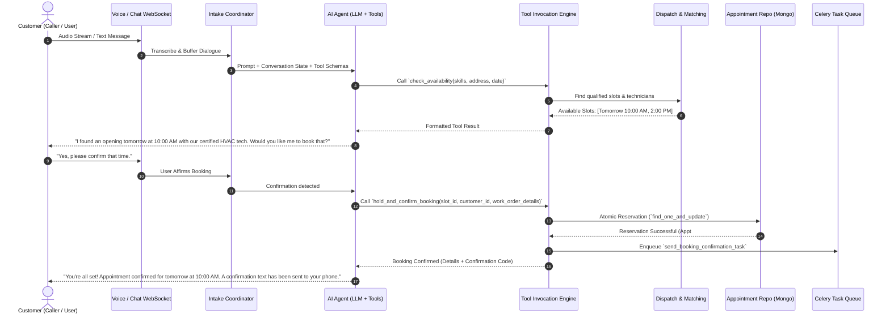
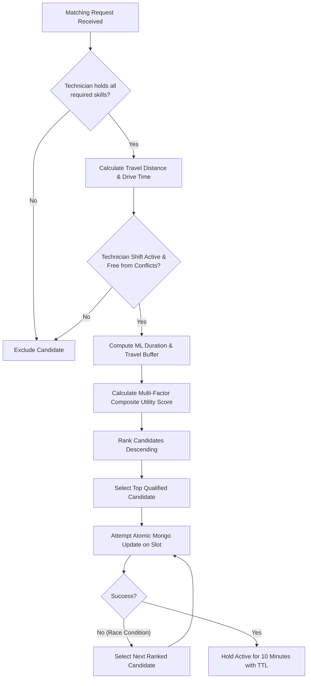

# FieldOps AI — Technical Architecture Document

**Document Version:** 1.0.0  
**Status:** Approved for Architecture & Implementation  
**Architectural Paradigm:** Hexagonal Modular Monolith  
**Runtime:** Python 3.12+ (FastAPI, Motor/PyMongo Async, Celery, Redis) & TypeScript (React 18+, Vite)  

---

## 1. Architectural Principles & System Boundary

### 1.1. Why a Modular Monolith?
Microservices introduce substantial overhead in distributed tracing, network serialization, event eventual consistency, and operational complexity. FieldOps AI is intentionally structured as a **Modular Monolith**:
- **Single Deployable Unit:** One backend service encapsulating all bounded domains, deployable as a single container or scaled horizontally behind a reverse proxy.
- **Strict In-Process Domain Boundaries:** Domains communicate via clean service interfaces, not raw database sharing or arbitrary internal imports.
- **Asynchronous Task Offloading:** Heavy, long-running, or failure-prone tasks (notifications, audio processing, ML model training) run asynchronously via Celery and Redis.
- **Microservice-Ready Packaging:** If a specific subsystem (e.g., the AI Voice Streaming Pipeline) requires independent scaling, its cleanly decoupled module can be split into a separate service with zero domain refactoring.

```
+---------------------------------------------------------------------------------------+
|                                    PRESENTATION LAYER                                 |
|   +-----------------------+   +------------------------+   +----------------------+   |
|   |  FastAPI REST Routers |   | WebSocket Voice Stream |   |  React / TS Frontend |   |
|   +-----------------------+   +------------------------+   +----------------------+   |
+-------------------------------------------|-------------------------------------------+
                                            |
+-------------------------------------------v-------------------------------------------+
|                                APPLICATION & AGENT LAYER                              |
|   +------------------------------------+   +--------------------------------------+   |
|   | Intake & Conversation Coordinator  |   | AI Tool Invocation & Guardrail Engine|   |
|   +------------------------------------+   +--------------------------------------+   |
|   +------------------------------------+   +--------------------------------------+   |
|   | Dispatch & Matching Orchestrator   |   | Scheduling & Booking Service         |   |
|   +------------------------------------+   +--------------------------------------+   |
+-------------------------------------------|-------------------------------------------+
                                            |
+-------------------------------------------v-------------------------------------------+
|                                      DOMAIN LAYER                                     |
|   +---------------------+   +----------------------+   +--------------------------+   |
|   |  Work Order State   |   |  Appointment State   |   |  Technician Geo & Skill  |   |
|   |     Machine         |   |      Machine         |   |       Matching Model     |   |
|   +---------------------+   +----------------------+   +--------------------------+   |
+---------------------|---------------------------------------------|-------------------+
                      |                                             |
+---------------------v------------------+       +------------------v-------------------+
|        PERSISTENCE & REPOSITORIES      |       |          INTEGRATION ADAPTERS        |
|  +----------------------------------+  |       |  +--------------------------------+  |
|  | CustomerRepository (MongoDB)     |  |       |  | Voice / Audio Adapter (Twilio) |  |
|  | WorkOrderRepository (MongoDB)    |  |       |  | LLM Adapter (OpenAI / Gemini)  |  |
|  | AppointmentRepository (MongoDB)  |  |       |  | Maps Adapter (OSRM / Google)   |  |
|  | TechnicianRepository (MongoDB)   |  |       |  | Notification (SMS / Email)     |  |
|  | IdempotencyRepository (Redis/DB) |  |       |  | Calendar Adapter (iCal / Cal)  |  |
|  +----------------------------------+  |       |  +--------------------------------+  |
+----------------------------------------+       +--------------------------------------+
                      |                                             |
+---------------------v---------------------------------------------v-------------------+
|                               INFRASTRUCTURE & WORKERS                                |
|   +---------------------+   +----------------------+   +--------------------------+   |
|   | MongoDB Async Clust |   | Redis (Cache & Lock) |   | Celery Background Queue  |   |
|   +---------------------+   +----------------------+   +--------------------------+   |
|   +-------------------------------------------------------------------------------+   |
|   | Machine Learning Inference Service (scikit-learn Duration & Risk Predictors)  |   |
+---------------------------------------------------------------------------------------+
```

---

## 2. Layered Responsibilities & Separation of Concerns

1. **API Layer (`app/api`):**  
   HTTP routes and WebSocket endpoints. Validates request envelopes, handles authentication/authorization tokens, injects dependencies, calls Application Services, and maps domain entities to response schemas. **Never executes direct database queries or raw business logic.**

2. **Schemas (`app/schemas`):**  
   Strict Pydantic v2 data models for request ingestion, response serialization, and external boundary data. Enforces types, string sanitization, and constraints.

3. **Application Services (`app/services`):**  
   Orchestrates domain workflows (e.g., `BookingService`, `IntakeService`, `DispatchService`). Coordinates domain models, repositories, integrations, and event publications. Enforces transactional and concurrency boundaries.

4. **Domain Layer (`app/domain`):**  
   Pure business logic, state machine specifications, domain invariants, entities, and value objects. **Zero dependencies on external frameworks, databases, or HTTP libraries.**

5. **Repositories (`app/repositories`):**  
   Data access abstraction over MongoDB (via Motor/PyMongo Async). Encapsulates queries, projections, indexes, and atomic updates. Returns domain models or clean data objects.

6. **Integrations & Adapters (`app/integrations`):**  
   Implements provider-independent interfaces (Ports) for external systems (Adapters). Every integration defines an abstract base class (`Protocol` or `ABC`) and provides both a production implementation and a high-fidelity `Mock` implementation for testing and offline development.

7. **Background Jobs (`app/tasks`):**  
   Celery task definitions and schedules. Consumes queue items from Redis, handles retries with exponential backoff, and publishes status updates.

8. **Machine Learning (`app/ml`):**  
   Job duration regression and missed-appointment risk classification. Contains model definitions, feature transformers, inference wrappers, training pipelines, and serialized model artifact management.

---

## 3. End-to-End System Workflows

### 3.1. Voice/Text Intake to Structured Work Order & Booking Flow



### 3.2. Technician Matching & Atomic Slot Reservation



---

## 4. Repository & Monorepo Folder Structure

```
fieldops-ai/
├── .env.example                     # Environment variable template
├── .gitignore                       # Git ignore rules
├── Dockerfile                       # Production multi-stage Docker build for backend
├── docker-compose.yml               # Local orchestration (FastAPI, Redis, Mongo, Celery, React)
├── pyproject.toml                   # Python dependencies, tools config (Ruff, Pytest)
├── README.md                        # Quickstart and overview
│
├── docs/                            # Production architecture & design specifications
│   ├── PRD.md                       # Product Requirements Document
│   ├── ARCHITECTURE.md              # Technical Architecture (this file)
│   ├── DATABASE_DESIGN.md           # Schema, state machines, indexes & concurrency
│   ├── API_SPECIFICATION.md         # Complete REST & WebSocket API specification
│   ├── IMPLEMENTATION_PLAN.md       # Phased roadmap, testing & acceptance criteria
│   └── SECURITY_AND_FAILURE_MODES.md# Threat model, PII redaction, retries & recovery
│
├── app/                             # Core Python backend (Modular Monolith)
│   ├── __init__.py
│   ├── main.py                      # FastAPI application factory, lifespan, middleware
│   │
│   ├── api/                         # Presentation Layer (HTTP & WebSockets)
│   │   ├── __init__.py
│   │   ├── deps.py                  # FastAPI dependency injection providers
│   │   ├── v1/
│   │   │   ├── __init__.py
│   │   │   ├── router.py            # Aggregated v1 API router
│   │   │   ├── auth.py              # JWT authentication & role-based access endpoints
│   │   │   ├── customers.py         # Customer CRUD & address management
│   │   │   ├── work_orders.py       # Work order creation, status, and triage
│   │   │   ├── appointments.py      # Slot discovery, holds, confirmations, reschedule
│   │   │   ├── technicians.py       # Technician directory, availability, GPS tracking
│   │   │   ├── dispatch.py          # Candidate matching & assignment endpoints
│   │   │   ├── intake.py            # Conversational text/chat intake sessions
│   │   │   ├── voice.py             # Voice telephony webhooks and streaming WebSocket
│   │   │   └── ml.py                # ML inference endpoints (duration & risk)
│   │   └── websockets/
│   │       ├── __init__.py
│   │       ├── connection_manager.py# WebSocket connection registry (dispatch events)
│   │       └── dispatch_feed.py     # Live dispatcher broadcast feed
│   │
│   ├── core/                        # Global configurations & cross-cutting utilities
│   │   ├── __init__.py
│   │   ├── config.py                # pydantic-settings configuration loading
│   │   ├── exceptions.py            # Standardized domain & HTTP exceptions
│   │   ├── logging.py               # Structured JSON logging & PII filter
│   │   ├── security.py              # Password hashing, JWT token handling
│   │   └── idempotency.py           # HTTP Idempotency-Key validation middleware
│   │
│   ├── domain/                      # Pure business logic & state machines
│   │   ├── __init__.py
│   │   ├── common.py                # Base entities, audit stamps, coordinates
│   │   ├── customer.py              # Customer domain entity & preferences
│   │   ├── work_order.py            # Work order entity, priority & state machine
│   │   ├── appointment.py           # Appointment entity, slot hold & state machine
│   │   ├── technician.py            # Technician entity, skills & shift rules
│   │   └── dispatch_policy.py       # Scoring algorithm & matching heuristics
│   │
│   ├── schemas/                     # Pydantic v2 request & response schemas
│   │   ├── __init__.py
│   │   ├── customer.py
│   │   ├── work_order.py
│   │   ├── appointment.py
│   │   ├── technician.py
│   │   ├── dispatch.py
│   │   ├── intake.py
│   │   └── ml.py
│   │
│   ├── repositories/                # Async MongoDB data access layer
│   │   ├── __init__.py
│   │   ├── base.py                  # Generic async MongoDB repository
│   │   ├── customer_repo.py
│   │   ├── work_order_repo.py
│   │   ├── appointment_repo.py
│   │   ├── technician_repo.py
│   │   └── idempotency_repo.py
│   │
│   ├── services/                    # Application orchestration services
│   │   ├── __init__.py
│   │   ├── intake_service.py        # Conversational session & slot extractor
│   │   ├── work_order_service.py    # Work order lifecycle orchestration
│   │   ├── appointment_service.py   # Concurrency-safe slot holds and bookings
│   │   ├── dispatch_service.py      # Candidate scoring and assignment
│   │   └── agent_service.py         # AI tool execution coordinator & guardrails
│   │
│   ├── integrations/                # Hexagonal adapters (Ports & Adapters)
│   │   ├── __init__.py
│   │   ├── base.py                  # Abstract protocols / interfaces
│   │   ├── voice/                   # Voice telephony & streaming adapters
│   │   │   ├── protocol.py
│   │   │   ├── mock_voice.py        # Deterministic mock adapter for local testing
│   │   │   └── twilio_voice.py      # Live Twilio Voice/MediaStream adapter
│   │   ├── llm/                     # Language model completion & tool-calling adapters
│   │   │   ├── protocol.py
│   │   │   ├── mock_llm.py          # Deterministic test agent for testing
│   │   │   └── openai_llm.py        # OpenAI/Gemini structured tool adapter
│   │   ├── maps/                    # Geocoding & distance calculation adapters
│   │   │   ├── protocol.py
│   │   │   ├── mock_maps.py         # Haversine / synthetic distance adapter
│   │   │   └── osrm_maps.py         # OSRM / Google Maps route adapter
│   │   ├── notifications/           # Customer notification adapters
│   │   │   ├── protocol.py
│   │   │   ├── mock_notifier.py     # In-memory logging notifier
│   │   │   └── twilio_sms.py        # SMS & WhatsApp adapter
│   │   └── calendar/                # Calendar invite generation (.ics)
│   │       ├── protocol.py
│   │       └── ical_adapter.py
│   │
│   ├── ml/                          # Machine Learning subsystem
│   │   ├── __init__.py
│   │   ├── pipeline.py              # Feature transformers & scikit-learn pipelines
│   │   ├── duration_model.py        # Job duration regression model
│   │   ├── risk_model.py            # Missed appointment risk classifier
│   │   ├── train.py                 # Training script using synthetic/historical data
│   │   └── artifacts/               # Serialized .joblib model files
│   │
│   ├── tasks/                       # Celery asynchronous worker tasks
│   │   ├── __init__.py
│   │   ├── celery_app.py            # Celery instance configuration & beat schedule
│   │   ├── notification_tasks.py    # Reminder dispatch, SMS broadcast
│   │   └── maintenance_tasks.py     # Expired hold sweeper, ML periodic batch scoring
│   │
│   └── scripts/                     # Developer utilities & database bootstrap
│       ├── __init__.py
│       ├── init_db.py               # Mongo collections & index initialization
│       └── seed_data.py             # Deterministic synthetic data generator
│
├── tests/                           # Comprehensive automated test suite
│   ├── __init__.py
│   ├── conftest.py                  # Pytest fixtures (async Mongo, mock adapters, client)
│   ├── unit/                        # Pure unit tests (state machines, scoring, ML)
│   │   ├── test_state_machines.py
│   │   ├── test_dispatch_scoring.py
│   │   ├── test_ml_pipelines.py
│   │   └── test_pii_logging.py
│   ├── integration/                 # Integration tests with async database
│   │   ├── test_work_order_repo.py
│   │   ├── test_atomic_booking.py
│   │   ├── test_idempotency.py
│   │   └── test_adapters.py
│   └── e2e/                         # End-to-end API & agent workflows
│       ├── test_intake_workflow.py
│       ├── test_dispatch_workflow.py
│       └── test_technician_flow.py
│
└── frontend/                        # React + TypeScript Web Application
    ├── package.json
    ├── tsconfig.json
    ├── vite.config.ts
    ├── index.html
    └── src/
        ├── App.tsx
        ├── main.tsx
        ├── api/                     # Axios/Fetch typed client wrappers
        ├── components/              # Shared UI components (Tailwind CSS)
        │   ├── ui/                  # Buttons, Modals, Badges, Tables
        │   └── common/              # Navbar, Sidebar, StatusPill
        ├── features/
        │   ├── dispatcher/          # Dispatcher Console
        │   │   ├── KanbanBoard.tsx  # Work order pipeline board
        │   │   ├── GanttSchedule.tsx# Technician daily schedule timeline
        │   │   └── MapView.tsx      # Technician live map & job pins
        │   ├── technician/          # Technician Mobile Web View
        │   │   ├── JobCard.tsx
        │   │   └── StatusUpdater.tsx# Quick action button (En Route, On Site, Done)
        │   └── customer_chat/       # Voice & text intake demo interface
        │       ├── AudioRecorder.tsx
        │       └── ChatWidget.tsx
        └── types/                   # TypeScript interfaces matching backend schemas
```

---

## 5. Concurrency & High-Availability Architecture

### 5.1. Concurrency Safety: Atomic Reservation Pattern
Booking collisions (two callers booking the exact same technician slot simultaneously) represent a critical failure in field operations. FieldOps AI eliminates this via **Conditional Atomic Updates** in MongoDB:

```python
# Atomic slot reservation query pattern
result = await db["appointments"].find_one_and_update(
    {"_id": appointment_id, "status": "AVAILABLE", "lock_version": current_version},
    {
        "$set": {
            "status": "TENTATIVE_HOLD",
            "reservation_token": new_uuid,
            "hold_expires_at": utc_now() + timedelta(minutes=10),
            "lock_version": current_version + 1,
            "updated_at": utc_now(),
        }
    },
    return_document=ReturnDocument.AFTER,
)
if not result:
    raise SlotConflictException("Slot was claimed or modified by another transaction.")
```

Additionally, active (non-cancelled) appointments for the same technician are protected by an application-level constraint and database compound indexing to guarantee zero overlapping time ranges.

### 5.2. Idempotent Request Ingestion
Clients provide an `Idempotency-Key` header with write requests (`POST /api/v1/work-orders`, `POST /api/v1/appointments/confirm`). 
- When an operation begins, an idempotency record is atomically inserted into MongoDB/Redis with status `PENDING` and a 24-hour TTL.
- If a duplicate key arrives while the request is in flight, the system returns `409 Conflict` or awaits resolution.
- Once completed, the response payload and HTTP status code are stored. Subsequent duplicate requests receive the cached response immediately, preventing duplicate tickets or double billing.

---

## 6. Integration Architecture & Hexagonal Adapter Pattern

All third-party services are wrapped behind Python abstract protocols. This enables running the entire application offline, executing lightning-fast deterministic test suites, and switching vendors without rewriting business logic.

```
+-----------------------------------------------------------+
|                   Hexagonal Port Interface                |
|                    `VoiceProviderProtocol`                |
+-----------------------------------------------------------+
                             ^
                             | (Implements)
              +--------------+--------------+
              |                             |
+---------------------------+ +-----------------------------+
|    `MockVoiceAdapter`     | |    `TwilioVoiceAdapter`     |
| (Local development & CI,  | | (Production Telephony,      |
|  deterministic audio test)| |  MediaStream WebSockets)    |
+---------------------------+ +-----------------------------+
```

