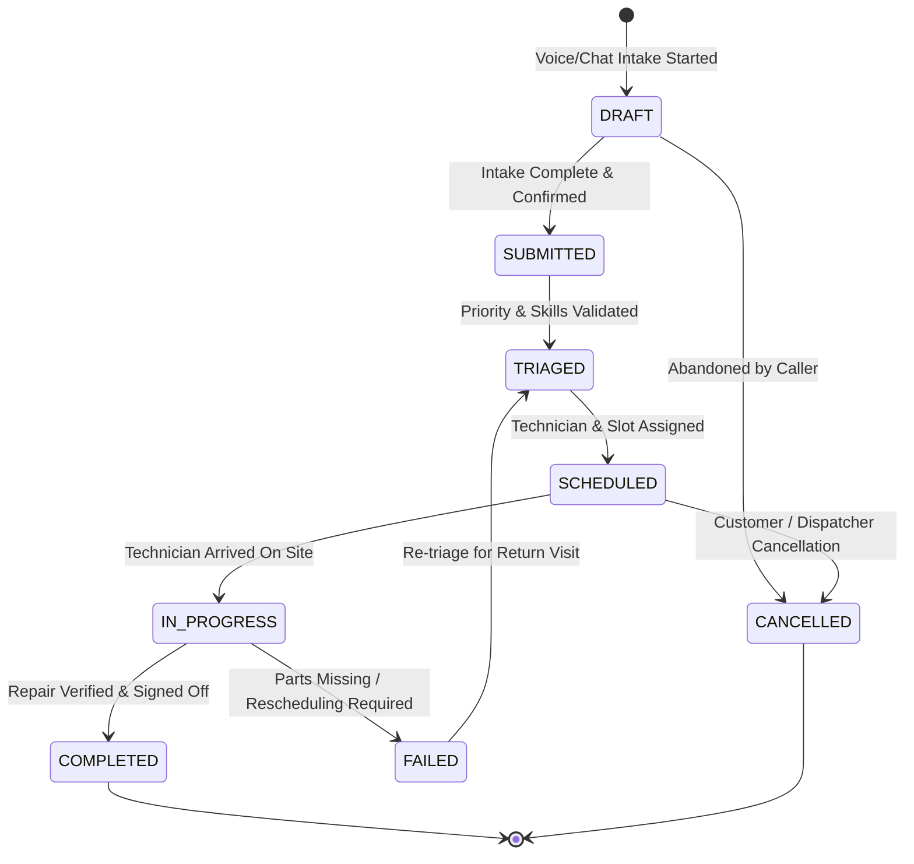
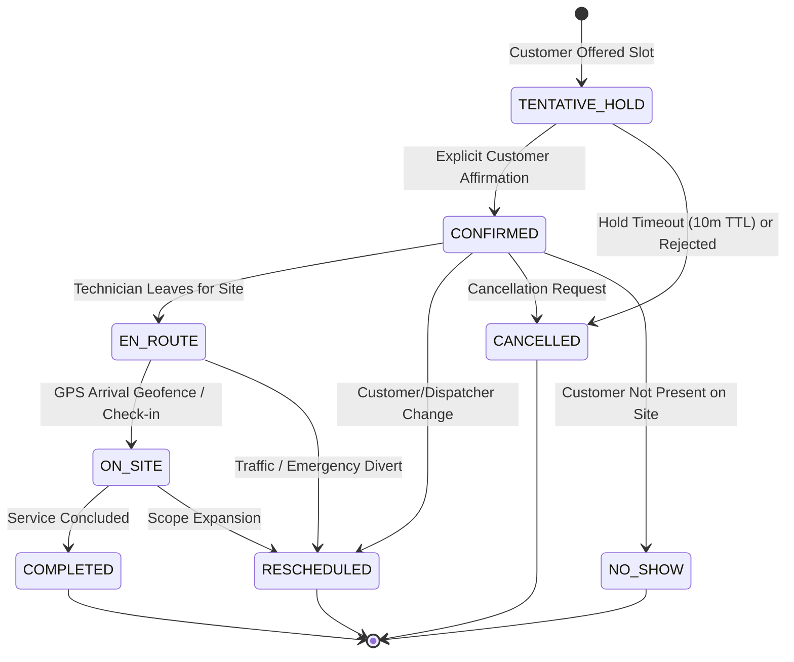

# FieldOps AI — Database Design & Data Integrity Specification

**Document Version:** 1.0.0  
**Status:** Approved for Architecture & Implementation  
**Primary Datastore:** MongoDB 7.0+ (PyMongo Async / Motor)  
**In-Memory Datastore & Cache:** Redis 7.2+  

---

## 1. Storage Architecture Overview

FieldOps AI utilizes **MongoDB** as its primary system of record for operational and historical data, and **Redis** for distributed locking, ephemeral holds, caching, and background task queues.

### 1.1. Why MongoDB for Field Service Operations?
- **Flexible Document Model:** Repair work orders, diagnostic metadata, equipment profiles, and AI conversation histories are inherently semi-structured and evolve across trades (e.g., HVAC requires refrigerant types and pressure readings; electrical requires panel amp ratings and circuit diagrams).
- **Native Geospatial Capabilities:** MongoDB provides high-performance 2dsphere indexing and geospatial aggregation pipelines (`$nearSphere`, `$geoWithin`) essential for real-time proximity matching between technicians and job sites.
- **Atomic Document-Level Operations:** MongoDB guarantees ACID transactions at the single-document level. Conditional atomic mutations (`find_one_and_update`) enable high-throughput, conflict-free appointment booking without heavy distributed locking overhead.

---

## 2. Collection Schemas & Data Models

### 2.1. `customers` Collection
Stores customer profiles, service addresses, communication channels, and aggregate metrics.

```json
{
  "_id": "ObjectId / UUID string (e.g., 'cust_01h8x...')",
  "full_name": "Eleanor Vance",
  "phone": "+14045550183",
  "email": "eleanor.vance@example.com",
  "preferred_channel": "VOICE | SMS | EMAIL",
  "service_addresses": [
    {
      "address_id": "addr_99182",
      "is_primary": true,
      "street": "1428 Elm Street",
      "unit": "Apt 4B",
      "city": "Atlanta",
      "state": "GA",
      "postal_code": "30309",
      "location": {
        "type": "Point",
        "coordinates": [-84.3880, 33.7490] // [longitude, latitude]
      },
      "access_instructions": "Gate code #4012, beware of golden retriever"
    }
  ],
  "total_completed_jobs": 4,
  "no_show_history_count": 0,
  "created_at": "2026-01-15T09:30:00Z",
  "updated_at": "2026-10-10T10:00:00Z"
}
```

### 2.2. `technicians` Collection
Stores technician credentials, certifications, current GPS location, working shifts, and home base.

```json
{
  "_id": "ObjectId / UUID string (e.g., 'tech_01h8y...')",
  "name": "Marcus Brody",
  "phone": "+14045550199",
  "email": "marcus.brody@fieldops.ai",
  "status": "ACTIVE | OFF_DUTY | ON_LEAVE",
  "skills": ["HVAC_EPA_CERTIFIED", "HEAT_PUMP_REPAIR", "HIGH_VOLTAGE"],
  "home_base": {
    "type": "Point",
    "coordinates": [-84.3600, 33.7800]
  },
  "current_location": {
    "type": "Point",
    "coordinates": [-84.3850, 33.7550],
    "updated_at": "2026-10-10T09:45:00Z"
  },
  "max_travel_radius_km": 40.0,
  "shift_schedule": {
    "timezone": "America/New_York",
    "weekly_hours": [
      {
        "day_of_week": "MONDAY",
        "start_time": "08:00",
        "end_time": "17:00"
      }
    ]
  },
  "rating": 4.92,
  "completed_jobs_count": 182,
  "created_at": "2025-06-01T08:00:00Z",
  "updated_at": "2026-10-10T09:45:00Z"
}
```

### 2.3. `work_orders` Collection
Central operational entity representing the customer service request, diagnostic details, and state machine.

```json
{
  "_id": "ObjectId / UUID string (e.g., 'wo_01h8z...')",
  "work_order_number": "WO-2026-10084",
  "customer_id": "cust_01h8x...",
  "source": "VOICE | CHAT | WEB | MANUAL",
  "category": "HVAC | PLUMBING | ELECTRICAL | APPLIANCE | ROOFING",
  "priority": "EMERGENCY | HIGH | MEDIUM | ROUTINE",
  "status": "DRAFT | SUBMITTED | TRIAGED | SCHEDULED | IN_PROGRESS | COMPLETED | CANCELLED | FAILED",
  "description": "Central AC compressor failing to ignite; fan spinning but blowing ambient warm air.",
  "symptoms": ["WARM_AIR", "COMPRESSOR_SILENT", "HUMMING_NOISE"],
  "required_skills": ["HVAC_EPA_CERTIFIED"],
  "service_address": {
    "street": "1428 Elm Street",
    "city": "Atlanta",
    "state": "GA",
    "postal_code": "30309",
    "location": {
      "type": "Point",
      "coordinates": [-84.3880, 33.7490]
    }
  },
  "intake_session_id": "sess_intake_00912",
  "ai_confidence_score": 0.94,
  "estimated_duration_minutes": 90,
  "predicted_by_ml": true,
  "assigned_technician_id": "tech_01h8y...",
  "active_appointment_id": "appt_01h9a...",
  "idempotency_key": "idemp_voice_sess_00912_req_1",
  "audit_trail": [
    {
      "transition_id": "tr_001",
      "from_status": "DRAFT",
      "to_status": "SUBMITTED",
      "actor": "AI_AGENT",
      "timestamp": "2026-10-10T09:12:00Z",
      "reason": "Voice intake dialogue completed and customer confirmed"
    }
  ],
  "created_at": "2026-10-10T09:10:00Z",
  "updated_at": "2026-10-10T09:15:00Z"
}
```

### 2.4. `appointments` Collection
Represents a booked or tentative calendar window linking a technician, customer, and work order.

```json
{
  "_id": "ObjectId / UUID string (e.g., 'appt_01h9a...')",
  "appointment_number": "APT-2026-5541",
  "work_order_id": "wo_01h8z...",
  "technician_id": "tech_01h8y...",
  "customer_id": "cust_01h8x...",
  "scheduled_start": "2026-10-11T14:00:00Z",
  "scheduled_end": "2026-10-11T15:30:00Z",
  "actual_start": null,
  "actual_end": null,
  "status": "TENTATIVE_HOLD | CONFIRMED | EN_ROUTE | ON_SITE | COMPLETED | RESCHEDULED | CANCELLED | NO_SHOW",
  "lock_version": 2,
  "reservation_token": "res_token_88ab7c",
  "hold_expires_at": null,
  "missed_appointment_risk_score": 0.18,
  "confirmation_channel": "VOICE_EXPLICIT",
  "reminder_sent_at": null,
  "customer_notes": "Call 15 minutes before arrival.",
  "technician_notes": null,
  "created_at": "2026-10-10T09:14:00Z",
  "updated_at": "2026-10-10T09:15:00Z"
}
```

### 2.5. `slot_reservations` Collection (Ephemeral Booking Holds)
Maintains short-lived tentative holds created during voice/chat interactions. Backed by a MongoDB TTL index.

```json
{
  "_id": "ObjectId",
  "reservation_token": "res_token_88ab7c",
  "technician_id": "tech_01h8y...",
  "scheduled_start": "2026-10-11T14:00:00Z",
  "scheduled_end": "2026-10-11T15:30:00Z",
  "customer_id": "cust_01h8x...",
  "created_at": "2026-10-10T09:12:00Z",
  "expires_at": "2026-10-10T09:22:00Z" // TTL expires after 10 minutes
}
```

### 2.6. `idempotency_records` Collection
Guarantees duplicate-safe execution of API mutations.

```json
{
  "_id": "ObjectId",
  "idempotency_key": "c7a82b9e-64c1-4b10-a2ef-9a57f8641b02",
  "request_fingerprint": "sha256_of_http_method_path_and_body",
  "status": "PENDING | COMPLETED | FAILED",
  "http_status_code": 201,
  "response_body": { "work_order_id": "wo_01h8z...", "status": "SUBMITTED" },
  "created_at": "2026-10-10T09:10:00Z",
  "expires_at": "2026-10-11T09:10:00Z" // 24-hour TTL
}
```

---

## 3. Explicit State Machines

### 3.1. Work Order Lifecycle State Machine



#### Valid Work Order State Transition Matrix

| Current State | Allowed Next States | Trigger Event / Actor | Invariants & Pre-Conditions |
| :--- | :--- | :--- | :--- |
| `DRAFT` | `SUBMITTED`, `CANCELLED` | Customer finished intake dialogue | Address, issue description, and customer phone validated. |
| `SUBMITTED` | `TRIAGED`, `CANCELLED` | Dispatch engine or human dispatcher | Category assigned, skill tags determined, duration estimated. |
| `TRIAGED` | `SCHEDULED`, `CANCELLED` | Slot reservation confirmed | Technician assigned, appointment created and confirmed. |
| `SCHEDULED` | `IN_PROGRESS`, `CANCELLED`, `SCHEDULED` (Reschedule) | Technician checks in on site | Appointment status must be `ON_SITE`. |
| `IN_PROGRESS` | `COMPLETED`, `FAILED` | Technician completes work or files exception | Resolution notes and parts recorded. |
| `FAILED` | `TRIAGED`, `CANCELLED` | Dispatcher initiates follow-up | Reason code recorded (e.g., `PARTS_BACKORDERED`). |
| `COMPLETED` | *Terminal State* | - | Invoices generated, survey queued. |
| `CANCELLED` | *Terminal State* | - | Associated holds or appointments cancelled. |

---

### 3.2. Appointment Lifecycle State Machine



#### Valid Appointment State Transition Matrix

| Current State | Allowed Next States | Transition Trigger | Guardrail Rules |
| :--- | :--- | :--- | :--- |
| `TENTATIVE_HOLD` | `CONFIRMED`, `CANCELLED` | Customer says "Yes" / TTL expiration | Affirmative verbal/written consent within 10-minute hold window. |
| `CONFIRMED` | `EN_ROUTE`, `RESCHEDULED`, `CANCELLED`, `NO_SHOW` | Technician departs / User change | Reschedule requires new slot hold check. |
| `EN_ROUTE` | `ON_SITE`, `RESCHEDULED`, `CANCELLED` | Technician taps "Arrived" or GPS geofence | ETA alerts emitted to customer. |
| `ON_SITE` | `COMPLETED`, `RESCHEDULED` | Work completed or job interrupted | Work order transitions to `COMPLETED` or `FAILED`. |
| `COMPLETED` | *Terminal State* | - | Time audit logged (`actual_start`, `actual_end`). |
| `CANCELLED` | *Terminal State* | - | Slot freed in technician schedule. |
| `NO_SHOW` | *Terminal State* | Technician waited $\ge 15$ mins | Updates customer `no_show_history_count`. |
| `RESCHEDULED` | *Terminal State* | Replaced by new appointment reference | Original record linked to replacement ID. |

---

## 4. Indexing Strategy & Performance Optimization

To achieve sub-millisecond document lookups and enforce absolute concurrency constraints, the following MongoDB indexes are created during initialization (`app/scripts/init_db.py`):

| Collection | Index Fields | Index Type | Purpose |
| :--- | :--- | :--- | :--- |
| `technicians` | `current_location: "2dsphere"` | Geospatial 2dsphere | Fast proximity queries (`$nearSphere`) for dispatch matching. |
| `technicians` | `home_base: "2dsphere"` | Geospatial 2dsphere | Route origin distance calculations. |
| `technicians` | `skills: 1, status: 1` | Compound B-tree | Filter active technicians by specific trade certifications. |
| `work_orders` | `work_order_number: 1` | Unique B-tree | Unique human-readable reference key. |
| `work_orders` | `customer_id: 1, created_at: -1` | Compound B-tree | Fast retrieval of customer service history. |
| `work_orders` | `status: 1, priority: 1` | Compound B-tree | High-throughput query index for Dispatcher Kanban board. |
| `work_orders` | `idempotency_key: 1` | Sparse Unique B-tree | Enforces one work order per idempotency key. |
| `work_orders` | `service_address.location: "2dsphere"` | Geospatial 2dsphere | Spatial cluster analysis for dispatch routing. |
| `appointments` | `appointment_number: 1` | Unique B-tree | Unique appointment identifier. |
| `appointments` | `technician_id: 1, scheduled_start: 1, status: 1` | Compound B-tree | Rapid conflict detection during slot discovery. |
| `appointments` | `work_order_id: 1` | B-tree | Reverse lookup from work order. |
| `appointments` | `scheduled_start: 1, status: 1` | Compound B-tree | Notification worker querying upcoming reminder targets. |
| `slot_reservations`| `expires_at: 1` | **TTL Index (`expireAfterSeconds: 0`)** | **Automatic MongoDB deletion of abandoned tentative holds.** |
| `slot_reservations`| `technician_id: 1, scheduled_start: 1` | Unique Compound | Prevents duplicate holds on the exact same technician window. |
| `idempotency_records`| `idempotency_key: 1` | Unique B-tree | Single flight request deduplication. |
| `idempotency_records`| `expires_at: 1` | **TTL Index (`expireAfterSeconds: 0`)** | Auto-purging of expired idempotency entries after 24 hours. |

---

## 5. Concurrency Strategy: Preventing Conflicting Appointments

Double bookings destroy operational trust and incur severe financial penalties. FieldOps AI implements a **Three-Tier Concurrency Protection Strategy**:

```
+---------------------------------------------------------------------------------+
|                                 TIER 1: API / REDIS                             |
|  - Idempotency-Key prevents duplicate network submissions.                       |
|  - Short-lived distributed lock on (technician_id, slot_date) during hold phase.|
+---------------------------------------------------------------------------------+
                                         |
                                         v
+---------------------------------------------------------------------------------+
|                           TIER 2: EPHEMERAL TTL HOLD                            |
|  - `slot_reservations` document inserted with 10-minute MongoDB TTL.            |
|  - Unique compound index prevents concurrent tentative holds for same window.   |
+---------------------------------------------------------------------------------+
                                         |
                                         v
+---------------------------------------------------------------------------------+
|                       TIER 3: ATOMIC CONDITIONAL CONFIRMATION                   |
|  - MongoDB `find_one_and_update` with optimistic `lock_version` check.          |
|  - Overlapping time range validation executed atomically.                       |
+---------------------------------------------------------------------------------+
```

### 5.1. The Atomic Booking Query Pattern
When converting a hold into a confirmed appointment, the service executes:

```python
async def confirm_appointment_atomic(
    self, reservation_token: str, work_order_id: str, customer_id: str
) -> Appointment:
    # 1. Validate the reservation hold has not expired
    reservation = await self.db["slot_reservations"].find_one(
        {"reservation_token": reservation_token, "expires_at": {"$gt": utc_now()}}
    )
    if not reservation:
        raise ReservationExpiredException(
            "Your reservation hold has expired. Please select a new slot."
        )

    # 2. Check for any overlapping CONFIRMED appointment for this technician
    conflict_count = await self.db["appointments"].count_documents(
        {
            "technician_id": reservation["technician_id"],
            "status": {"$in": ["CONFIRMED", "EN_ROUTE", "ON_SITE"]},
            "scheduled_start": {"$lt": reservation["scheduled_end"]},
            "scheduled_end": {"$gt": reservation["scheduled_start"]},
        }
    )
    if conflict_count > 0:
        raise SlotConflictException(
            "The selected technician is no longer available during this time."
        )

    # 3. Create confirmed appointment and remove the ephemeral hold atomically in a transaction or sequential step
    appointment_doc = {
        "appointment_number": generate_appointment_number(),
        "work_order_id": work_order_id,
        "technician_id": reservation["technician_id"],
        "customer_id": customer_id,
        "scheduled_start": reservation["scheduled_start"],
        "scheduled_end": reservation["scheduled_end"],
        "status": "CONFIRMED",
        "lock_version": 1,
        "created_at": utc_now(),
        "updated_at": utc_now(),
    }
    await self.db["appointments"].insert_one(appointment_doc)
    await self.db["slot_reservations"].delete_one({"_id": reservation["_id"]})

    return Appointment(**appointment_doc)
```

