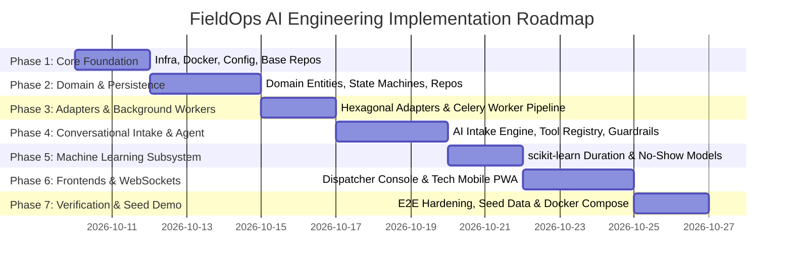

# FieldOps AI — Phased Implementation Plan & Engineering Roadmap

**Document Version:** 1.0.0  
**Status:** Approved for Implementation  
**Methodology:** Incremental Delivery, Test-Driven Verification, Strict Dependency Gates  

---

## 1. Implementation Philosophy & Delivery Guardrails

To prevent premature complexity and maintain production reliability, the implementation follows strict architectural rules:
1. **Zero Greenfield Breakages:** Every phase must produce fully tested, runnable code with zero syntax errors, passing Ruff linter checks, and passing Pytest test suites.
2. **Ports Before Concrete Vendors:** Integrations (Voice, LLM, Maps, Notifications, Calendar) must be implemented with strict Abstract Protocols and high-fidelity Mock Adapters *first*. Real third-party adapters inherit the same interfaces.
3. **Deterministic Testing:** No external network requests during unit or integration testing. All tests run locally against in-memory mocks, async MongoDB, and Redis.
4. **Data Integrity First:** Concurrency controls, idempotency mechanisms, and state machines are locked down before building user interfaces.

---

## 2. Phased Roadmap Overview

---

## 3. Detailed Phase Breakdown

### Phase 1: Core Infrastructure, Configuration & Data Bootstrap
- **Scope & Objectives:**
  - Initialize project configuration via `pyproject.toml` (Python 3.12, FastAPI, Motor/PyMongo, Redis, Celery, scikit-learn, Ruff, Pytest, HTTPX).
  - Setup `pydantic-settings` environment configuration with strict validation in `app/core/config.py`.
  - Implement structured JSON logging with custom PII redaction filter in `app/core/logging.py`.
  - Build MongoDB connection manager and lifespan management in `app/main.py`.
  - Create database index initialization script (`app/scripts/init_db.py`) covering 2dsphere, compound, and TTL indexes.
  - Implement HTTP `Idempotency-Key` middleware and storage in `app/core/idempotency.py`.
  - Setup `docker-compose.yml` with MongoDB, Redis, and FastAPI hot-reload container.
- **Key Deliverables:**
  - `pyproject.toml`, `.env.example`, `Dockerfile`, `docker-compose.yml`.
  - `app/core/config.py`, `app/core/logging.py`, `app/core/idempotency.py`.
  - `app/repositories/base.py`, `app/scripts/init_db.py`.
  - Base FastAPI health endpoints (`GET /health`, `GET /ready`).
- **Acceptance Criteria:**
  - `docker compose up` starts FastAPI, MongoDB, and Redis without errors.
  - `pytest tests/unit/test_pii_logging.py` passes with 100% of PII strings redacted in log output.
  - Indexes verify successfully via `app/scripts/init_db.py`.
  - `ruff check .` passes with zero violations.

---

### Phase 2: Domain Logic, State Machines & Repositories
- **Scope & Objectives:**
  - Implement pure domain entities: `Customer`, `WorkOrder`, `Appointment`, `Technician`.
  - Implement domain state machines for Work Orders and Appointments with explicit transition validations and error handling.
  - Build concrete MongoDB repositories (`CustomerRepository`, `WorkOrderRepository`, `AppointmentRepository`, `TechnicianRepository`).
  - Implement the **Atomic Slot Hold and Booking** mechanism using MongoDB conditional updates (`find_one_and_update`) and conflict detection.
  - Implement multi-factor dispatch matching algorithm (`app/domain/dispatch_policy.py`).
- **Key Deliverables:**
  - `app/domain/*.py` (pure business logic, zero external I/O).
  - `app/repositories/*.py` (Motor async queries and mutations).
  - `app/schemas/*.py` (Pydantic v2 request/response schemas).
  - `app/services/work_order_service.py`, `app/services/appointment_service.py`, `app/services/dispatch_service.py`.
- **Acceptance Criteria:**
  - State machine unit tests verify all valid transitions and reject all illegal transitions with `InvalidStateTransitionException`.
  - Concurrent booking test (`tests/integration/test_atomic_booking.py`) runs 20 simultaneous booking attempts for the same single slot: **exactly 1 succeeds, 19 fail with clean 409 conflict errors.**
  - Work order creation with an `Idempotency-Key` prevents duplicates when replayed.

---

### Phase 3: External Integration Adapters & Background Workers
- **Scope & Objectives:**
  - Define Abstract Protocols for external boundaries in `app/integrations/base.py`:
    - `VoiceProviderProtocol`: Telephony session initiation, audio streaming.
    - `LLMProviderProtocol`: Structured completion, tool calling.
    - `MapsProviderProtocol`: Geocoding, travel distance, drive time calculation.
    - `NotificationProtocol`: SMS, Email, voice status dispatch.
    - `CalendarProtocol`: iCalendar (`.ics`) generation.
  - Build high-fidelity `Mock` adapters for each protocol for local offline development and test execution.
  - Implement concrete adapters: `TwilioVoiceAdapter`, `OpenAILLMAdapter`, `OSRMMapsAdapter`, `TwilioSMSNotifier`, `ICalAdapter`.
  - Configure Celery app with Redis broker (`app/tasks/celery_app.py`).
  - Implement Celery background tasks: `send_appointment_confirmation`, `send_appointment_reminder`, `prune_expired_reservations`.
- **Key Deliverables:**
  - `app/integrations/**` (Protocols, Mocks, and Production implementations).
  - `app/tasks/celery_app.py`, `app/tasks/notification_tasks.py`.
  - Unit tests for all adapters verifying protocol conformance.
- **Acceptance Criteria:**
  - Mock adapters provide deterministic output without external API keys.
  - Celery worker successfully consumes tasks from Redis and executes retries with exponential backoff upon simulated failure.

---

### Phase 4: Conversational AI Intake Engine & Guardrail Tool Registry
- **Scope & Objectives:**
  - Implement conversational intake coordinator (`app/services/intake_service.py`).
  - Build AI Agent Tool Registry (`app/services/agent_service.py`) exposing strictly typed tools:
    - `lookup_customer(phone)`
    - `check_availability(skills, address, date)`
    - `hold_slot(technician_id, slot_window)`
    - `confirm_booking(reservation_token, work_order_details)`
  - Enforce the **Consequential Booking Confirmation Boundary**:
    - The agent is prevented from executing `confirm_booking` unless the caller has explicitly confirmed the time and address.
  - Implement conversational slot-filling pipeline handling speech-to-text transcript chunks, extracting repair symptoms, category, urgency, and address.
  - Implement REST intake routes (`POST /intake/conversations/...`) and WebSocket audio streaming endpoint (`/voice/ws/{session_id}`).
- **Key Deliverables:**
  - `app/services/intake_service.py`, `app/services/agent_service.py`.
  - `app/api/v1/intake.py`, `app/api/v1/voice.py`.
  - Comprehensive intake conversation test suite (`tests/e2e/test_intake_workflow.py`).
- **Acceptance Criteria:**
  - AI agent safely extracts structured work order slots from simulated audio/text transcripts.
  - Attempting to book without user confirmation triggers a validation error and prompts the caller for explicit approval.
  - Idempotent booking succeeds on user confirmation and emits background confirmation tasks.

---

### Phase 5: Machine Learning Models (Job Duration & No-Show Risk)
- **Scope & Objectives:**
  - Implement scikit-learn feature preprocessing pipeline (`app/ml/pipeline.py`):
    - Categorical encoders for trade category, symptom tags, property type, day of week.
    - Numerical scalers for equipment age, technician experience, lead time hours.
  - Implement `DurationRegressor` (RandomForestRegressor / GradientBoostingRegressor) predicting service duration in minutes.
  - Implement `NoShowClassifier` (LogisticRegression / HistGradientBoostingClassifier) predicting probability of missed appointment.
  - Build synthetic training dataset generator and offline training script (`app/ml/train.py`).
  - Serialized model persistence via `joblib` into `app/ml/artifacts/`.
  - Implement inference service with fallback heuristics if model artifacts are missing.
- **Key Deliverables:**
  - `app/ml/pipeline.py`, `app/ml/duration_model.py`, `app/ml/risk_model.py`, `app/ml/train.py`.
  - `app/api/v1/ml.py` (REST inference endpoints).
  - Unit tests verifying model predictions, bounds ($R^2$, ROC-AUC), and inference latency (< 10ms).
- **Acceptance Criteria:**
  - Duration model predicts realistic durations (30 to 240 minutes) with sensible margins.
  - Risk model flags high-lead-time routine appointments with elevated no-show scores.
  - Graceful fallback: If models fail to load, heuristic rules supply default durations (60 mins) and risk scores (0.1) without crashing the application.

---

### Phase 6: Frontend Applications (Dispatcher Console & Technician Interface)
- **Scope & Objectives:**
  - Initialize React + TypeScript application in `frontend/` with Vite and Tailwind CSS.
  - Build **Dispatcher Dashboard**:
    - Real-time **Kanban Board** with drag-and-drop / column status updates (`SUBMITTED`, `TRIAGED`, `SCHEDULED`, `IN_PROGRESS`).
    - **Schedule Timeline (Gantt View)** displaying technician daily schedules, booked blocks, and open slots.
    - **Interactive Map View** showing technician GPS pins and work order service locations.
    - WebSocket client subscribing to `/api/v1/ws/dispatch-feed` for instant schedule and status updates.
  - Build **Technician Mobile Web View**:
    - Daily job manifest with customer contact, equipment diagnostics, and gate notes.
    - Action buttons: `En Route`, `Arrived / On Site`, `Job Complete`.
  - Build **Customer Voice/Chat Intake Sandbox**:
    - Audio microphone streaming simulator and interactive chat box demonstrating real-time slot extraction and booking confirmation.
- **Key Deliverables:**
  - Complete `frontend/src` codebase with typed API clients and responsive UI.
  - Nginx configuration / Vite preview setup in Docker.
- **Acceptance Criteria:**
  - Dispatcher board reflects status updates within 500ms of backend mutation via WebSocket.
  - Technician interface can transition appointment states and submit job completion notes.
  - Customer intake widget allows end-to-end conversational booking simulation.

---

### Phase 7: End-to-End Hardening, Seed Data & Production Verification
- **Scope & Objectives:**
  - Build deterministic synthetic seed generator (`app/scripts/seed_data.py`):
    - Seeds 10 technicians across Metro Atlanta with realistic skills and home bases.
    - Seeds 50 customers with geocoded addresses.
    - Seeds 100 historical work orders for ML baseline training.
    - Seeds 20 active work orders and appointments across all states to populate the dashboard immediately.
  - Create complete E2E automated test suite (`tests/e2e/test_dispatch_workflow.py`, `tests/e2e/test_technician_flow.py`).
  - Verify complete Docker Compose stack (`docker compose up --build`).
- **Key Deliverables:**
  - `app/scripts/seed_data.py`.
  - Full test suite passing in CI / local test runner.
  - Docker Compose verified demo environment.
- **Acceptance Criteria:**
  - Single command `docker compose up --build` brings up backend, MongoDB, Redis, Celery, and frontend.
  - Database seed populates all views with rich, realistic field operations data.
  - 100% of automated tests pass without network dependencies.

---

## 4. Testing & Verification Matrix

| Test Suite | Purpose | Execution Speed | Dependencies |
| :--- | :--- | :--- | :--- |
| **Unit Tests (`tests/unit`)** | Test state machines, scoring algorithms, ML pipeline math, PII logging. | < 5 seconds | Pure Python (In-Memory) |
| **Integration Tests (`tests/integration`)** | Test MongoDB repositories, atomic updates, idempotency, adapter contracts. | < 20 seconds | Async MongoDB, In-Memory Redis |
| **Concurrency Tests (`tests/integration/test_atomic_booking.py`)** | Verify zero double bookings under heavy simulated concurrent race conditions. | < 10 seconds | Async MongoDB |
| **E2E API Tests (`tests/e2e`)** | Verify full intake-to-dispatch-to-completion workflow via HTTPX AsyncClient. | < 30 seconds | Full FastAPI test app |
| **Lint & Quality (`ruff check`)** | Enforce PEP 8, type safety, unused imports, formatting conventions. | < 2 seconds | Ruff |

