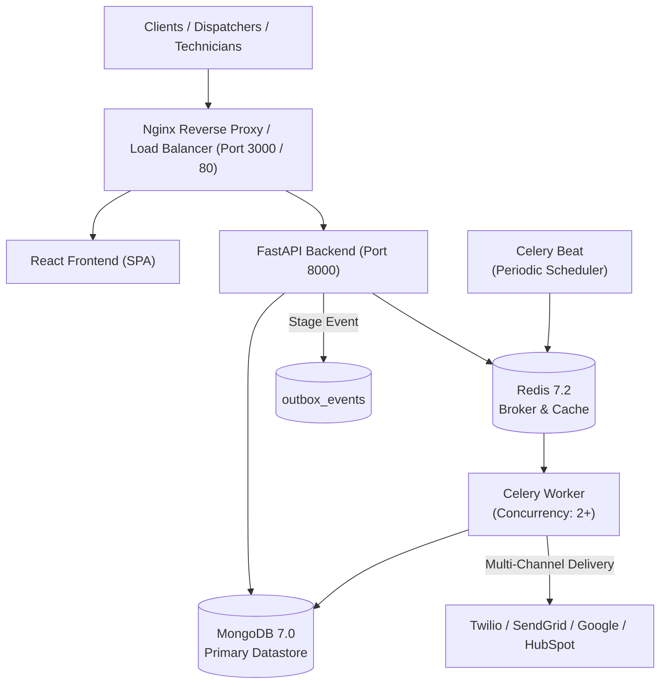

# FieldOps AI — Operations Runbook & SRE Playbook

**Version:** 1.0.0  
**Target Environment:** Production / Staging  
**Primary Datastores:** MongoDB 7.0 (Motor Async), Redis 7.2  
**Task Workers:** Celery 5.4+  

---

## 1. System Overview & Architecture



---

## 2. Standard Operational Procedures (SOPs)

### 2.1 Starting the Services

#### With Docker Compose:
```bash
# Build and launch all services in detached mode
docker compose up -d --build

# Verify all containers are healthy
docker compose ps
```

#### Verification Probes:
```bash
# Liveness probe (checks process responsiveness)
curl -f http://localhost:8000/api/v1/health

# Readiness probe (verifies active MongoDB connection pool)
curl -f http://localhost:8000/api/v1/ready

# Operational metrics & telemetry
curl http://localhost:8000/api/v1/metrics
```

### 2.2 Stopping & Restarting Services Gracefully
Always allow stop grace periods so in-flight tasks and database transactions finish cleanly:

```bash
# Graceful stop (allows 30s for workers to finish batches)
docker compose stop

# Restart a specific service (e.g. background worker)
docker compose restart celery-worker

# Full teardown without removing persistent volumes
docker compose down
```

### 2.3 Accessing Logs & Correlation IDs
Every request emits a unique `X-Request-ID` correlation identifier:

```bash
# View backend application logs
docker compose logs -f app

# Search logs for a specific request ID
docker compose logs app | grep "req_a1b2c3d4e5f6"

# Monitor Celery worker execution
docker compose logs -f celery-worker
```

---

## 3. Database Maintenance, Backup & Restore

### 3.1 MongoDB Hot Backup (`mongodump`)
Execute consistent backups using `mongodump` with gzip compression and the `--oplog` flag:

```bash
#!/bin/bash
BACKUP_DIR="/backups/mongodb/$(date +%Y%m%d_%H%M%S)"
mkdir -p "$BACKUP_DIR"

# Run mongodump from host or container
docker exec fieldops-mongo mongodump \
  --db fieldops_dev \
  --gzip \
  --out /data/db/backup_temp

# Copy backup to secure storage
docker cp fieldops-mongo:/data/db/backup_temp "$BACKUP_DIR"
docker exec fieldops-mongo rm -rf /data/db/backup_temp

echo "Backup completed to $BACKUP_DIR"
```

### 3.2 MongoDB Restore Procedure (`mongorestore`)
To restore a point-in-time snapshot to a clean or staging instance:

```bash
# 1. Copy backup archive into container
docker cp /backups/mongodb/20261011_120000/fieldops_dev fieldops-mongo:/data/db/restore_data

# 2. Restore with drop option (replaces existing collections cleanly)
docker exec fieldops-mongo mongorestore \
  --db fieldops_dev \
  --gzip \
  --drop \
  /data/db/restore_data

# 3. Clean up container temporary files
docker exec fieldops-mongo rm -rf /data/db/restore_data

# 4. Verify collection indexes
python -m app.scripts.init_db
```

### 3.3 Index Verification & Re-indexing
If indexes require re-initialization or rebuild:
```bash
# Rebuild all indexes across users, customers, technicians, work orders, appointments, and outbox
python -m app.scripts.init_db
```

---

## 4. Background Processing & Transactional Outbox Runbook

### 4.1 Monitoring Queue Depths & Workers
```bash
# Ping active Celery workers
docker exec fieldops-celery-worker celery -A app.core.celery_app inspect ping

# Inspect currently executing tasks
docker exec fieldops-celery-worker celery -A app.core.celery_app inspect active

# Inspect scheduled periodic beat tasks
docker exec fieldops-celery-worker celery -A app.core.celery_app inspect scheduled
```

### 4.2 Inspecting Dead-Letter Queue (DLQ)
When events fail after 5 attempts, they transition to `status: DEAD_LETTER`:

```bash
# Query dead-letter events via Admin API
curl -s http://localhost:8000/api/v1/integrations/outbox/dead-letter \
  -H "Authorization: Bearer <ADMIN_TOKEN>" | jq .
```

### 4.3 Safe DLQ Replay Procedure
Once downstream connectivity (e.g. SMS provider) is restored:

```bash
# Replay specific event by event_id (resets retry_count to 0 and status to PENDING)
curl -X POST http://localhost:8000/api/v1/integrations/outbox/replay/<EVENT_ID> \
  -H "Authorization: Bearer <ADMIN_TOKEN>"

# Trigger an immediate outbox processing batch
curl -X POST http://localhost:8000/api/v1/integrations/outbox/process \
  -H "Authorization: Bearer <ADMIN_TOKEN>"
```

### 4.4 Worker Crash Recovery
If a worker crashes while holding events in `status: IN_FLIGHT`, the next processing cycle automatically reclaims stale events older than 5 minutes (`stale_threshold = 300s`) and resets them for retry with full backoff.

---

## 5. Incident Response & Disaster Recovery Playbooks

### Playbook 1: Database Connection Pool Exhaustion / Unhealthy Probes
**Symptom:** `/api/v1/ready` returns HTTP 503; logs report `ServerSelectionTimeoutError`.
1. Check MongoDB container health:
   ```bash
   docker compose ps mongo
   docker compose logs --tail=50 mongo
   ```
2. Check MongoDB open connections:
   ```bash
   docker exec fieldops-mongo mongosh --eval "db.serverStatus().connections"
   ```
3. If pool is exhausted, increase `MONGODB_MAX_POOL_SIZE` in `.env` (default 50) and restart the application container:
   ```bash
   docker compose restart app
   ```

---

### Playbook 2: Downstream Notification Provider Failure (Twilio / SendGrid)
**Symptom:** Outbox failure metrics increase; events transition to `FAILED` with retry backoff.
1. Inspect integration metrics:
   ```bash
   curl http://localhost:8000/api/v1/integrations/metrics -H "Authorization: Bearer <ADMIN_TOKEN>"
   ```
2. Verify provider credentials and network status.
3. If the outage is extended (> 2 hours):
   - Outbox events automatically apply exponential backoff up to 300 seconds and stop retrying after 5 attempts, landing in `DEAD_LETTER`.
   - No customer data or work order state is lost.
4. Once upstream provider resolves:
   - Run replay script across all DLQ events.

---

### Playbook 3: High CPU / Latency During Machine Learning Ingestion
**Symptom:** `/api/v1/ml/predict/duration` or `/api/v1/ml/predict/risk` latency exceeds 1500ms.
1. Check process CPU consumption:
   ```bash
   docker stats fieldops-backend
   ```
2. Verify feature drift telemetry:
   ```bash
   curl "http://localhost:8000/api/v1/ml/monitoring/drift" -H "Authorization: Bearer <DISPATCHER_TOKEN>"
   ```
3. Immediate remediation:
   - Scale Uvicorn worker threads or run FastAPI with `--workers 4`.
   - If model artifacts are corrupted, remove artifacts from `app/ml/artifacts/`; the service immediately defaults to deterministic category heuristics (`used_fallback: true`) with sub-5ms latency.

---

### Playbook 4: Stale Tentative Appointment Holds
**Symptom:** Customers report available slots are blocked or marked unavailable.
1. Run on-demand reservation cleanup:
   ```bash
   docker exec fieldops-celery-worker celery -A app.core.celery_app call app.tasks.maintenance_tasks.cleanup_expired_reservations_task
   ```
2. Verify `slot_reservations` collection TTL index:
   ```bash
   docker exec fieldops-mongo mongosh fieldops_dev --eval "db.slot_reservations.getIndexes()"
   ```

---

## 6. Prometheus Observability & Alerting Thresholds

Configure Prometheus to scrape `http://fieldops-backend:8000/api/v1/metrics`:

### Recommended Alerting Rules
| Alert Name | Metric Condition | Severity | Action |
| :--- | :--- | :---: | :--- |
| `HighHttpErrorRate` | `rate(error_count[5m]) / rate(request_count[5m]) > 0.03` | Critical | Inspect `/api/v1/metrics` status breakdown and error logs. |
| `HighApiLatencyP95` | `latency_ms.p95 > 1000` | Warning | Check ML threadpool contention or slow MongoDB queries. |
| `DeadLetterQueueAccumulation` | `dead_letter_events > 5` | High | Check downstream notification provider credentials and availability. |
| `DatabaseReadinessDown` | `probe_success{job="fieldops_ready"} == 0` | Critical | Immediate MongoDB restart or failover to secondary replica. |
| `CeleryWorkerUnreachable` | `celery_inspect_ping == 0` | High | Restart `celery-worker` container. |

---

## 7. Secrets Rotation Runbook

### 7.1 Rotating `JWT_SECRET_KEY`
1. Generate a new 64-character cryptographically secure hex secret:
   ```bash
   python -c "import secrets; print(secrets.token_hex(32))"
   ```
2. Update `JWT_SECRET_KEY` in production environment or vault.
3. Restart `app` container:
   ```bash
   docker compose restart app
   ```
4. *Impact:* Active user sessions will expire and require re-login.

### 7.2 Rotating `WEBHOOK_SIGNING_SECRET`
1. Generate new 32-character signing secret.
2. Update webhook sender (Twilio console or external service).
3. Update `WEBHOOK_SIGNING_SECRET` in `.env`.
4. Reload FastAPI application without downtime.

